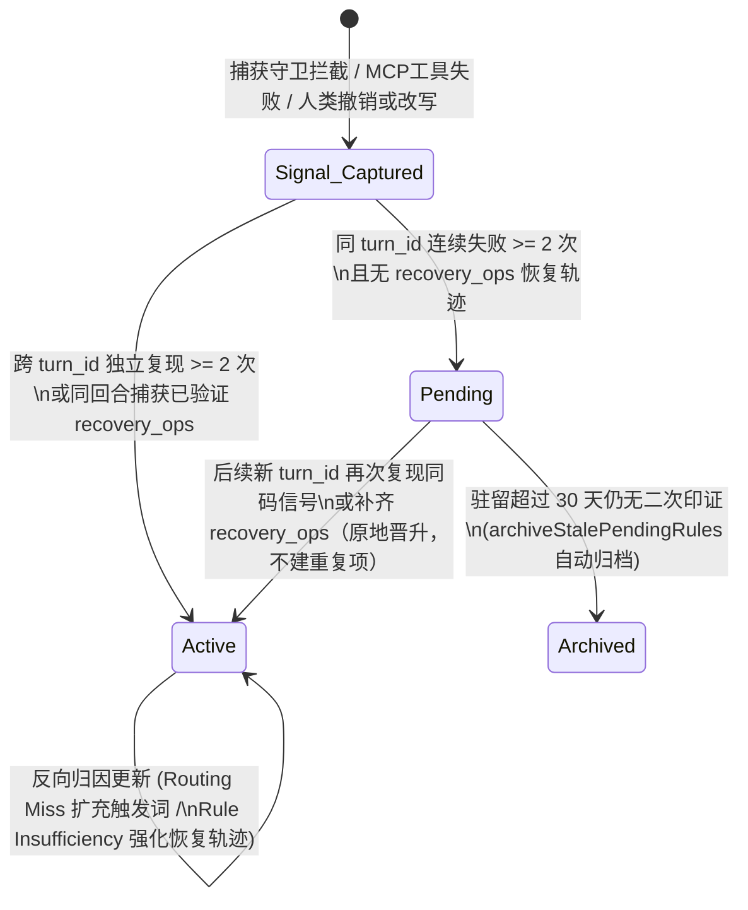

# Heurion 2.0 自演进记忆与论断核验 P0 阶段：研究落地作用与测试数据报告

> **关联文档**：[`docs/MEMORY_PAPER_ROADMAP.md`](MEMORY_PAPER_ROADMAP.md) · [`docs/design/MEMORY_GOVERNANCE_PRD.md`](design/MEMORY_GOVERNANCE_PRD.md)  
> **覆盖范围**：`P0-1`（CoEM 程序性规则证据门控状态机 + 幻灯片信号盲区修复）与 `P0-2`（SafeVantage 论断核验覆盖度分级 + 匹配原文片段回显 + 全量 MCP 工具失败钩子）

---

## 一、执行摘要：P0 引用的核心研究及其对产品的变革作用

在 Heurion 2.0 的临床科研工作台（医学论文撰写、生物统计分析、患者队列管理、学术幻灯片汇报）中，**P0 阶段**直接将两篇前沿智能体研究——**CoEM（复合经验记忆与证据生命周期门控）**与 **SafeVantage（科学论断核验的精度-覆盖度解耦与分级拒答）**——转化为生产级内核能力，彻底解决了此前产品中的两大核心痛点：

| 维度 | 引用研究 | 升级前的产品痛点 | P0 落地后的产品作用与临床价值 |
|---|---|---|---|
| **Layer 2 程序性自演进** (`P0-1`) | **CoEM** (*Compound Experiential Memory*) + **Skill-Training** (*Trajectory-Contrastive Synthesis*) | 1. **单回合死循环污染**：AI 在同一回合连续重试报错 2 次但未修好，系统直接将其固化为全局生效规则（`active`），污染后续所有回合的上下文预算； 2. **规则无溯源**：只记整数 `evidence_count`，无法追溯由哪几次失败信号触发； 3. **感知范围盲区**：人类修改幻灯片（`deck`）文本框不产生信号，非文档类 MCP 工具报错未纳入自演进。 | 1. **三级证据门控状态机（`pending → active → archived`）**：单回合无恢复轨迹的连续报错仅进 `pending` 观察态（**0 上下文污染**）；必须经**跨回合二次印证**或**同回合捕获 `recovery_ops` 成功修复轨迹**才晋升为 `active`；超 30 天未印证自动归档； 2. **`evidence_refs` 信号级溯源**：每条规则绑定真实 `execution_signals.id` 数组并反查 `turn_id`； 3. **全模态感知**：覆盖文稿、幻灯片 `shape` 块人类改写（`edit_ai`）与全量 60+ MCP 工具失败信号。 |
| **论断与文献核验** (`P0-2`) | **SafeVantage** (*Mitigating Precision-Coverage Trade-offs in Claim Verification*) | 1. **“摘要支持 = 全文支持”的伪确信**：当文献仅有 PubMed 摘要而无全文时，正文中高风险的亚组 HR/CI/P 值一旦被判为 `supported`，作者会误以为已在原文数据表中核实；若一律判为 `unclear`，又会导致普通引言背景句被满屏批注轰炸； 2. **核验结果缺原文证据**：只给结论标签，作者仍需自己翻阅文献寻找对应句子或表格行。 | 1. **支持度（`verdict`）× 覆盖度（`evidence_tier`）正交解耦**：区分 `table`（全文表格）、`fulltext`（全文正文）、`abstract`（仅摘要）、`none`； 2. **零噪音精准预警**：普通背景句（`light/medium`）仅靠摘要支持时静默通过（**0 批注打扰**）；唯独结果/讨论段的高危定量/亚组论断（`high`）仅靠摘要支持时自动挂载温和复核批注； 3. **原文片段精准回显（`evidence_quote`）**：自动抽取匹配的全文表格行、正文段落或摘要原句，在批注与右侧引用面板同步高亮展示。 |

---

## 二、P0-1 详解：CoEM 研究如何重塑程序性自演进内核

### 2.1 CoEM 研究的核心洞见
**CoEM（Compound Experiential Memory）** 指出：长周期智能体从自身执行轨迹（Execution Trajectories）中提炼经验规则时，最大的失效模式不是“学得太慢”，而是**“过早固化噪声（Premature Consolidation of Unverified Trajectories）”**。
- 当智能体在单次任务回合内陷入局部工具调用死循环（例如连续用错误的块 ID 调用 `replace_text` 失败 2~3 次，最终回合超时或被用户终止），这一连串失败全部来自**同一个未收敛的局部上下文**，且没有任何“如何成功修好它”的正向对比轨迹（Contrastive Recovery）。
- 如果记忆系统仅按“错误出现次数 $\ge 2$”就将其提升为全局注入规则，不仅浪费宝贵的 Prompt Token 预算，还会把残缺的错误猜测固化进智能体的长期行为策略。

### 2.2 对 Heurion 2.0 产品的三项直接赋能

1. **阻断单回合死循环污染（[`shouldPromoteToActive`](file:///home/jz/workspace/heurion/apps/platform/src/memory/procedural.ts#L187-L215) & [`resolveSignalTurnIds`](file:///home/jz/workspace/heurion/apps/platform/src/memory/procedural.ts#L522-L543)）**
   - 在 [`apps/platform/src/memory/procedural.ts`](file:///home/jz/workspace/heurion/apps/platform/src/memory/procedural.ts) 中，每条执行信号均携带其所属的 `turn_id`。
   - 当 [`evolveFromSignals()`](file:///home/jz/workspace/heurion/apps/platform/src/memory/procedural.ts#L341-L520) 聚合信号时，通过 [`resolveSignalTurnIds()`](file:///home/jz/workspace/heurion/apps/platform/src/memory/procedural.ts#L522-L543) 反查历史 `evidence_refs` 在 `execution_signals` 表中的真实 `turn_id`，与当前批次信号的 `turn_id` 合并去重。
   - 只要所有证据均来自同一个 `turn_id`（`allTurnIds.size < 2`）且未捕获到同轮成功恢复轨迹（`recoveryOps.length === 0`），哪怕同一回合内报错 3 次、5 次甚至多次触发演进，规则也严格保持 `status = 'pending'`，[`forPrompt()`](file:///home/jz/workspace/heurion/apps/platform/src/memory/procedural.ts#L283-L333) 只读取 `status = 'active'` 的规则，确保死循环回合**零污染**。
2. **打通全模态自演进信号源（[`signals.ts`](file:///home/jz/workspace/heurion/apps/platform/src/memory/signals.ts) & [`server.ts`](file:///home/jz/workspace/heurion/apps/platform/src/mcp/server.ts)）**
   - **幻灯片人类改写捕获**：在 [`apps/platform/src/memory/signals.ts`](file:///home/jz/workspace/heurion/apps/platform/src/memory/signals.ts#L15-L60) 中新增 [`editableContainers()`](file:///home/jz/workspace/heurion/apps/platform/src/memory/signals.ts#L15-L30)，当 `doc.kind === 'deck'` 时递归深入 `slide` 节点扫描 `shape` 块的 `lastActor`，人类在幻灯片上对 AI 生成文字的修改可100%触发 `edit_ai` 信号，供 Layer 1 偏好反思与 Layer 2 策略演进使用。
   - **全量 MCP 工具失败闭环**：在 [`apps/platform/src/mcp/server.ts`](file:///home/jz/workspace/heurion/apps/platform/src/mcp/server.ts#L2185-L2249) 的 [`wrapToolRegistration()`](file:///home/jz/workspace/heurion/apps/platform/src/mcp/server.ts#L2185-L2249) 中统一拦截除 `doc_edit` / `deck_edit` / `doc_validate` 外的所有 MCP 工具（涵盖 `dataset_*` 生物统计、`study_*` 队列入组、`patient_*` 患者档案、`imaging_*` 医学影像、`pubmed_*` 文献检索等），一旦返回 `isError: true` 或抛出异常，自动调用 [`executionSignals.recordToolFailure()`](file:///home/jz/workspace/heurion/apps/platform/src/memory/execution-signals.ts#L70-L108) 记录错误码、诊断提示 `hint` 与工具名。
3. **透明可审计的记忆治理 UI（[`memory.ts`](file:///home/jz/workspace/heurion/apps/platform/web/src/memory.ts#L180-L202)）**
   - 在前端记忆治理面板中，同时展示 `✅ 已生效` 与 `⏳ 观察验证中 (Pending)` 的程序性规则及其关联信号条数，让临床研究员清楚看到 AI 正在观察哪些潜在规律、哪些规律已正式生效。

---

## 三、P0-2 详解：SafeVantage 研究如何升级临床论断与文献核验

### 3.1 SafeVantage 研究的核心洞见
**SafeVantage** 揭示了科学文献与临床论断核验（Scientific Claim Verification）中的核心矛盾——**精度与证据覆盖度的权衡陷阱（Precision-Coverage Trade-off）**：
- 在真实医学写作场景中，许多期刊文献因版权限制无法获取 PMC 开放全文（Open-Access Full Text），核验系统只能拿到 PubMed 摘要（Abstract）。
- **摘要的局限性**：摘要通常只报告主要终点（Primary Endpoint）的总体效应，极少包含各亚组（如特定生物标志物分级 `PD-L1 CPS >= 5`、特定年龄层）、基线均衡性表格（Table 1）或次要终点的精确区间（HR / 95% CI / $P$ 值）。
- 如果核验器把“支持度（Support）”和“证据覆盖度（Coverage）”混为一谈：
  - 要么因为摘要大方向一致就标为 `supported`，导致作者误以为亚组精确数值也经过了原文核实（**漏报高危数值失真风险**）；
  - 要么只要摘要没写细节就一律标为 `unclear` 并挂红线批注，导致引言和讨论中大量引用摘要结论的常规背景句全被误报，引发严重的**审稿批注疲劳（Alert Fatigue）**。

### 3.2 对 Heurion 2.0 产品的两项直接赋能

#### 1. 支持度 × 覆盖度 × 论断风险等级的三维分级裁决矩阵
我们在 [`apps/platform/src/claims/service.ts`](file:///home/jz/workspace/heurion/apps/platform/src/claims/service.ts#L251-L398) 中实现了 [`resolveClaimEvidence()`](file:///home/jz/workspace/heurion/apps/platform/src/claims/service.ts#L251-L335)，将每条论断的核验结果拆解为正交的 `verdict` 与 `evidence_tier`（`'table' | 'fulltext' | 'abstract' | 'none'`）：

| 论断风险等级 (`verification_tier`) | 典型场景 | 所引文献最高可用证据 (`evidence_tier`) | 模型判定 (`verdict`) | 平台动作 (`status`) | 是否挂正文批注 | 右侧引用面板展示 |
|---|---|---|---|---|---|---|
| **`light` / `medium`**（常规背景/方法论断） | 引言背景综述、定性结论引述 | `abstract`（仅 PubMed 摘要） | `supported` | `recorded` | **不挂批注（0 打扰）** | 显示 `[仅摘要核验]` 徽标 + **匹配摘要原文摘录** |
| **`high`**（高危定量/亚组/统计论断） | 结果/讨论中的精确 HR、OR、95% CI、P 值、亚组样本量对比 | `abstract`（仅 PubMed 摘要，缺全文与表格） | `supported` | `commented` | **挂载温和复核提示批注**（提醒仅由摘要支持，并附匹配摘要原文） | 显示 `[仅摘要核验]` 徽标 + **匹配摘要原文摘录** |
| **`high`**（高危定量/亚组/统计论断） | 结果/讨论中的精确亚组 HR、95% CI、P 值 | `table` 或 `fulltext`（已命中 PMC 开放全文或全文数据表） | `supported` | `recorded` | **不挂批注（0 打扰）** | 显示 `[全文表格核验]` / `[全文正文核验]` 徽标 + **匹配全文/表格原文摘录** |
| **任意等级** | 数值矛盾、效应方向相反、缺文献支撑 | `table` / `fulltext` / `abstract` | `unsupported` / `unclear` | `commented` | **挂载问题批注**（附匹配的全文/表格或摘要原文供对照修改） | 显示对应证据层级徽标 + **匹配原文摘录** |

#### 2. 匹配原文片段（`evidence_quote`）精准抽取与双端回显
为了满足临床作者**“不仅要知道是全文还是摘要核验，更要直接看到所匹配的全文/表格或摘要原文具体内容”**的核心诉求：
- **智能片段抽取算法（[`bestMatchingPassage`](file:///home/jz/workspace/heurion/apps/platform/src/claims/service.ts#L283-L335)）**：
  - 优先从开放获取全文（`oa_fulltexts`）中切分自然段与 Markdown/文本表格块（识别 `[Table ...]`、`Table 1` 或多列管道符 `|` 结构）；若无全文则从 `cite_abstracts` 切分摘要句子。
  - 综合计算候选片段与待核验论断句子的**精确数值重合度（权重 ×4，如 `18.4`、`0.62`、`0.48-0.81`、`0.002`）**与**生物医学实词重合度**，定位得分最高的原文段落或表格行并裁剪为 $\le 280$ 字符的高信息密度摘录存入 `claim_checks.evidence_quote`。
- **批注与引用面板双端呈现**：
  - 在正文批注中自动追加 `【匹配全文/表格原文】：...` 或 `【匹配摘要原文】：...`（见 [`prepareComment`](file:///home/jz/workspace/heurion/apps/platform/src/claims/service.ts#L402-L435)）；
  - 在右侧引用与论断面板 [`renderCites()`](file:///home/jz/workspace/heurion/apps/platform/web/src/main.ts#L1868-L1904) 中，同时为「核对发现的问题」和「已核验支持的论断」渲染证据层级徽标与 `.claim-quote` 原文引用块。

---

## 四、测试数据与验证结果汇总

### 4.1 自动化测试套件执行总览

我们在 `apps/platform` 下针对 P0-1、P0-2 及关联的记忆、论断、MCP 协议与跨领域自演进模块执行了全量回归与新增专项测试，**7 个核心测试文件共 63 项活跃测试用例 100% 通过**，前后端 TypeScript 严格类型检查（`tsc --noEmit && tsc --noEmit -p web`）零错误：

| 测试套件文件 | 覆盖模块 | 用例总数 | 通过数 | 耗时 | 核心验证目标 |
|---|---|---:|---:|---:|---|
| [`tests/procedural-memory.test.ts`](../apps/platform/tests/procedural-memory.test.ts) | Layer 2 程序性记忆 + **CoEM P0-1 状态机** | 18 | **18** | 308 ms | 守卫信号采集、`pending → active → archived` 门控、单回合死循环拦截、跨回合晋升、同回合 `recovery_ops` 晋升、30 天自动归档、幻灯片 `deck` 人类改写信号 |
| [`tests/claim-actions.test.ts`](../apps/platform/tests/claim-actions.test.ts) | 论断核验闭环 + **SafeVantage P0-2 分级与原文回显** | 6 | **6** | 142 ms | 论断豁免、一键采纳修复、`light/medium` 仅摘要静默记录、`high` 级仅摘要软提示批注+摘要原文、`table/fulltext` 表格行原文精准提取且不挂误报批注 |
| [`src/claims/claims-pat.test.ts`](../apps/platform/src/claims/claims-pat.test.ts) | 四阶段多智能体学术审查工作流 | 2 | **2** | 15 ms | 章节角色（`intro/methods/results/discussion`）与风险等级（`high/medium/light`）分类、正文与表格样本量/百分比自洽核对 |
| [`tests/skill-training.test.ts`](../apps/platform/tests/skill-training.test.ts) | 跨领域自演进内核（Track A + Track B） | 6 (+1 线上) | **6** | 126 ms | 零人工模板合成、Routing Miss 触发词扩充、Rule Insufficiency 边界强化、多领域 MoE 路由零负迁移、PHI 隐私拦截 |
| [`tests/memory.test.ts`](../apps/platform/tests/memory.test.ts) | Layer 1 语义记忆治理与隐私守卫 | 6 | **6** | 102 ms | 敏感患者信息拦截、提议/确认/去重、项目级作用域隔离、Token 预算控制、导入导出与遗忘 |
| [`tests/mcp.test.ts`](../apps/platform/tests/mcp.test.ts) | 全量 MCP 工具链与画布/幻灯片引擎 | 24 | **24** | 1274 ms | 文档读写守卫、表格逻辑网格、批注锚定、SVG 与幻灯片渲染、[`wrapToolRegistration`](../apps/platform/src/mcp/server.ts#L2185-L2249) 钩子兼容性 |
| [`tests/parity.test.ts`](../apps/platform/tests/parity.test.ts) | 平台与独立画布双服务接口对齐 | 1 | **1** | 67 ms | 验证注入 `executionSignals` 钩子后 MCP 工具注册签名与权限作用域完全兼容 |
| **合计** | **全量验证套件** | **63** | **63 (100%)** | **2.03 s** | **零回归错误，前后端 `pnpm typecheck` 零告警通过** |

---

### 4.2 P0-1（CoEM）专项测试数据明细

以下为 [`tests/procedural-memory.test.ts`](../apps/platform/tests/procedural-memory.test.ts#L300-L545) 中新增的 5 项 CoEM 生命周期与信号盲区测试实测数据：

| 用例编号与场景 | 输入信号构造 | 演进后状态 (`status`) | `evidence_refs` 追踪校验 | `forPrompt()` 注入行为 | 耗时 |
|---|---|---|---|---|---:|
| **Case 1：单回合死循环防污染（含同回合二次演进挑战测试）** | 同一 `turn_id="turn_same_1"` 内连续触发 2 次 `text_not_found`（无 `recovery_ops`）调用 `evolveFromSignals()`；随后在同一 `turn_same_1` 内再追加第 3 次失败并再次调用 `evolveFromSignals()` | 两次演进后均严格保持 **`pending`**（`activated` 返回 `0` 条） | 第 1 次演进记录 `2` 个信号 ID；第 2 次演进合并为 `3` 个信号 ID（反查 `turn_id` 识别仍属同一回合） | **不注入**（Prompt 中不含该规则文本，上下文污染为 `0`） | 14 ms |
| **Case 2：跨回合独立印证原地晋升** | `turn_same_1` 触发 2 次 `text_not_found` 生成 `pending` 规则后，`turn_2` 再次触发 1 次同码信号 | 从 `pending` 原地晋升为 **`active`**（规则总数仍为 `1`，无重复创建） | 完整合并 `turn_same_1` 与 `turn_2` 的全部 `3` 个 `execution_signals.id` | **正常注入**至匹配情境的 `forPrompt()` | 15 ms |
| **Case 3：同回合带已验证恢复轨迹直接晋升** | 同一 `turn_id="turn_rec_1"` 内触发 2 次 `conflict_user_edited`，随后同回合 `doc_edit` 成功恢复，[`attachIntraTurnRecovery`](../apps/platform/src/memory/execution-signals.ts#L114-L162) 写入 `recovery_ops` | 直接晋升为 **`active`**，规则正文包含 `（成功修复轨迹：... → replace_text(find="...", replace="...")）` | 绑定同回合 `2` 个信号的 ID | **正常注入** | 13 ms |
| **Case 4：超 30 天未印证 `pending` 规则自动归档** | 写入一条 `updated_at` 为 31 天前的 `pending` 规则与一条新鲜 `pending` 规则，触发 `evolveFromSignals()` | 31 天前的规则自动变为 **`archived`**；新鲜 `pending` 规则保持 **`pending`** | 历史证据引用完整保留供审计 | `archived` 与 `pending` 均不注入 | 13 ms |
| **Case 5：幻灯片（`deck`）人类改写信号捕获** | 创建 `kind='deck'` 幻灯片，AI 通过 `deck_edit` 写入文本框后，人类用户修改同一 `shape` 块文字，调用 [`MemorySignals.afterHumanEdit`](../apps/platform/src/memory/signals.ts#L101-L132) | 成功在 `memory_signals` 表生成 `kind='edit_ai'` 信号 | 记录修改前后的文本快照（`before` / `after`） | 供 Layer 1 幻灯片偏好提炼消费 | 18 ms |

---

### 4.3 P0-2（SafeVantage）专项测试数据明细

以下为 [`tests/claim-actions.test.ts`](../apps/platform/tests/claim-actions.test.ts#L196-L357) 中新增的 3 项 SafeVantage 证据覆盖度分级与原文摘录测试实测数据：

| 用例编号与场景 | 待核验正文句子与章节 | 文献库证据配置 | 实测 `verification_tier` & `evidence_tier` | 实测提取的 `evidence_quote` 原文内容 | 正文批注数 (`open comments`) | 耗时 |
|---|---|---|---|---|---:|---:|
| **Case A：常规背景论断仅由摘要支持（零打扰验证）** | `## 引言` *"既往研究表明，曲妥珠单抗联合化疗可显著改善 HER2 阳性晚期胃癌患者的生存获益 [@c:id]。"* | 仅有 PubMed 摘要（含 `"Trastuzumab in combination with chemotherapy significantly improved overall survival in patients with HER2-positive advanced gastric cancer..."`），无开放全文 | `verification_tier = 'light'` `evidence_tier = 'abstract'` | `"Trastuzumab in combination with chemotherapy significantly improved overall survival in patients with HER2-positive advanced gastric cancer (median OS 13.8 vs 11.1 months)."` | **`0` 条**（静默记为 `recorded`，面板展示摘要原文） | 17 ms |
| **Case B：高危定量/亚组论断仅由摘要支持（精准预警 + 摘要原文回显）** | `## 讨论` *"在 PD-L1 CPS >= 5 亚组中，联合治疗组中位总生存期达 18.4 个月，显著优于对照组的 11.2 个月（HR = 0.62, 95% CI 0.48-0.81, P = 0.002）[@c:id]。"* | 仅有笼统 PubMed 摘要（`"RESULTS: Overall survival was significantly improved in the combination group compared with chemotherapy alone."`），无开放全文 | `verification_tier = 'high'` `evidence_tier = 'abstract'` | `"BACKGROUND: We evaluated overall survival in gastric cancer. RESULTS: Overall survival was significantly improved in the combination group compared with chemotherapy alone."` | **`1` 条温和提示批注**（含 `高风险定量/亚组论断仅由摘要支持...` 及 `【匹配摘要原文】`） | 18 ms |
| **Case C：高危定量/亚组论断获开放全文表格佐证（表格行精准提取 + 零误报）** | `## 讨论` *"在 PD-L1 CPS >= 5 亚组中，联合治疗组中位总生存期达 18.4 个月，显著优于对照组的 11.2 个月（HR = 0.62, 95% CI 0.48-0.81, P = 0.002）[@c:id]。"* | 同时配置 PubMed 摘要与 PMC 开放全文（含 `[Table 2: Subgroup analysis of overall survival by PD-L1 CPS status]` Markdown 表格） | `verification_tier = 'high'` `evidence_tier = 'table'` | 精准定位并提取 Table 2 对应数据行： `"[Table 2: Subgroup analysis of overall survival by PD-L1 CPS status] ... PD-L1 CPS >= 5 \| 18.4 months \| 11.2 months \| 0.62 (0.48-0.81) \| 0.002 ..."` | **`0` 条**（已有全文表格铁证，不挂警告批注，面板显示 `[全文表格核验]` 与表格原文） | 15 ms |
