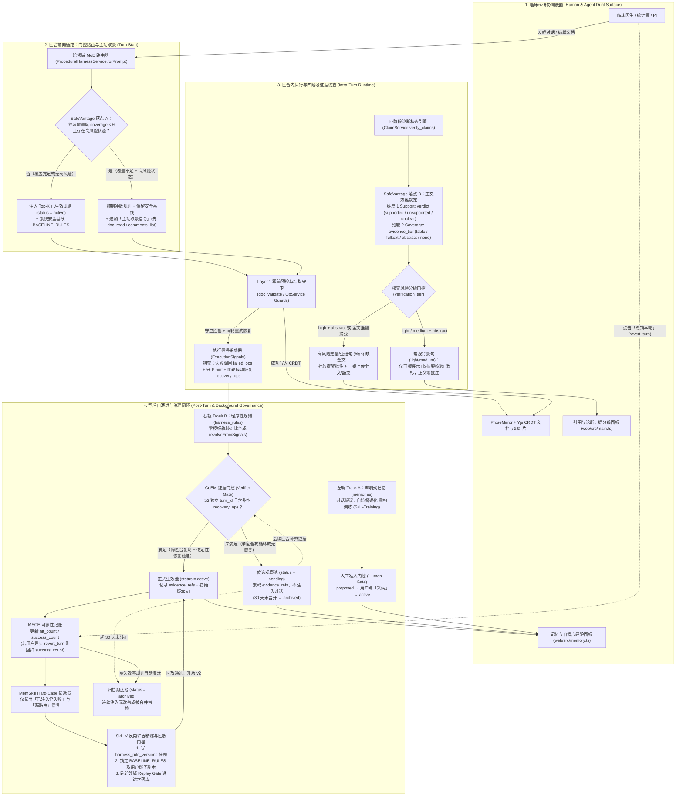
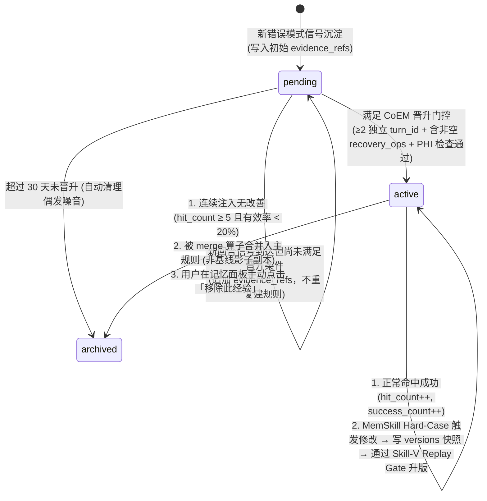

# PRD：Heurion 2.0 自演进记忆治理与可验证证据分级

- **文档状态**：Draft v1.0（已对齐 [`docs/MEMORY_PAPER_ROADMAP.md`](../MEMORY_PAPER_ROADMAP.md) 修正版）
- **关联代码模块**：`src/memory/procedural.ts`、`src/claims/service.ts`、`src/store/db.ts`、`web/src/main.ts`、`web/src/memory.ts`
- **目标用户**：临床医生（论文第一作者/通讯作者）、生物统计师、专病队列研究员、课题组 PI

---

## 1. 背景与核心问题：为什么要做这次升级？

Heurion 2.0 已经具备了「三层自演进记忆架构」与「四阶段文献论断核对（`verify_claims`）」，但在真实临床科研写作的长期使用中，用户仍会遇到三类直接影响信任感的问题：

1. **偶发报错被当成「永久规矩」（规则准入太草率）**
   - **现状**：AI 在单次回合内因死循环重试触发 2 次守卫报错，即使最终没有修复成功，也会立刻变成一条全局生效（`active`）的执行规则。
   - **用户痛点**：医生感觉「AI 某次抽风卡住之后，后面好几次对话都带着奇怪的教条，越改越死板」。
2. **文献核对只有「支持/不支持」，看不出证据深浅，且容易产生批注噪音（证据覆盖度缺失）**
   - **现状**：PubMed 上 70%–80% 的临床文献受版权限制只有摘要、没有开放全文。现有核对把「仅凭摘要泛泛提及」和「经开放全文及 RCT 表格逐行核实」都标成一样的绿色 `支持 (supported)`；反之，如果把仅摘要支持都当成问题挂批注，正文中八成正常引用都会被黄色警告淹没。
   - **用户痛点**：医生在写核心结果/讨论的亚组数据（如特定人群 HR、P 值）时，不知道这个「支持」到底只是摘要里顺带一提，还是真正核对过原文表格；同时又不希望引言里几十条普通背景文献被满屏警告批注打扰。
3. **跨领域或多批注复杂稿件下，AI 容易「没看清就下手」或「越学越退步」（缺少主动取景与防退化回放）**
   - **现状**：新用户刚导入一篇带十几条合作者批注的 Word 稿，或刚切到幻灯片/统计模块时，AI 手里缺乏高置信度经验，却强行注入仅靠历史频次凑分的无关规则直接改写，频繁触发拦截重试；长期使用后，后台规则合并还可能冲掉系统底线守卫的用户副本。
   - **用户痛点**：聊天框里经常看到 AI 先报错再重试，或者感觉「今天教会它做 PPT，明天它反而忘了怎么改论文」。

---

## 2. 新一代自演进记忆与证据治理架构（Target Architecture & End-to-End Logic）

为了彻底解决上述三大痛点，本次升级在 Heurion 2.0 原有「三层自演进架构 + 四阶段文献核查」的基础上，引入了 **「双轨准入对称性（CoEM）」**、**「覆盖度感知与主动取景（SafeVantage）」** 以及 **「全生命周期治理闭环（MSCE + MemSkill + Skill-V）」**。

### 2.1 核心设计哲学：三条架构不变量

1. **双轨准入对称性（Symmetric Admission Gates）**：
   - **Track A（声明式记忆 `memories`）** 存的是**医生的主观偏好与学科写作规范**（如「P 值保留三位小数」「基线表偏态变量用 Median [IQR]」），AI 无法替医生做主，因此走 **人工审批准入（Human-in-the-Loop Gate：`proposed → active`）**。
   - **Track B（程序性规则 `harness_rules`）** 存的是**底层工具与文档 AST 的客观操作规程**（如「段落含未关闭批注时必须传 `ack_comments`」「非相邻段落 `merge` 前需先 `move`」），医生不需要懂底层 API，但系统绝不能把未经验证的报错直接当规矩，因此走 **验证器证据门控准入（Verifier-in-the-Loop Gate：`pending → active`）**。
2. **相关性（Support/Relevance）与覆盖度（Coverage）正交解耦**：
   - 在**规则路由侧**：区分「某条规则历史频次高」与「当前领域/文档状态真的被覆盖」；覆盖不足时宁可先调用只读工具「主动取景（Active Vantaging）」，也不乱塞规则盲目改写。
   - 在**文献核查侧**：区分「文献是否支持该句结论（`verdict`）」与「支撑该结论的证据深浅（`evidence_tier: abstract | fulltext | table | none`）」，结合章节风险等级决定是静默展示徽标还是挂批注预警。
3. **只进不退的演进安全网（Monotonic Non-Regression）**：
   - 规则不仅要能「生（合成）」，还要能「考（记录实战有效率 `success_count / hit_count`）」、「改（针对 Hard Case 精炼并通过历史回放 Replay Gate）」和「死（长期低效或超期未转正自动 `archived`）」，且系统 5 条安全基线（含用户同源影子副本）永不被破坏。

---

### 2.2 架构全景图（Architecture Panorama）

---

### 2.3 端到端全链路运行逻辑（5 个阶段的完整闭环）

为了把整个系统如何协同工作讲清楚，我们按时间顺序追踪**一次用户请求从发起、执行、核查到课后进化**的完整生命周期：

#### 阶段 ①：回合启动 —— 门控路由与「不知则先取景」（Forward Routing & SafeVantage A）
当用户在对话框输入指令（如*「把方法段第一句改紧凑些」*）时：
1. **读取实时环境线索（`docState`）**：系统毫秒级扫描当前 CRDT 文档，提取 4 个实时布尔状态：近期是否有人工修改（`recentUserEdits`）、是否有未关闭批注（`openComments`）、是否有待采纳修订（`pendingSuggestions`）、是否包含表格（`hasTable`），并识别当前任务所属领域（`manuscript` / `biostats` / `deck`）。
2. **加载已生效规则**：只从数据库加载 `status = 'active'` 的程序性规则（处于 `pending` 观察期的候选规则被严格物理隔离，绝不进入提示词）。若用户已有某条系统基线规则（`BASELINE_RULES`）的个人演化副本，则用个人副本替代系统基线参与打分。
3. **效用打分与跨领域防串台（MoE Utility Scoring）**：
   $$\text{Score} = 0.1 \times \text{evidence\_count} + 5 \times \mathbb{I}(\text{关键词命中}) + 8 \times \mathbb{I}(\text{文档状态命中}) + \text{领域门控}(+4 / -20)$$
   跨领域强冲突规则（得分 $<-10$）被直接过滤。
4. **SafeVantage 落点 A（覆盖度检查与主动取景）**：
   - 系统计算该用户在当前领域的经验覆盖度 `coverage`。
   - 若 `coverage < θ`（例如新用户或刚切到陌生领域），系统**剔除那些既没命中关键词也没命中文档状态、纯粹靠历史 `evidence_count` 凑分的规则**，但**强制保留系统 `BASELINE_RULES` 及命中了实时状态的守卫规则**。
   - 若此时文档存在高风险状态（如段上有合作者未关闭的批注 `openComments = true`），而选出的规则里又没有覆盖该状态的经验，系统在提示词末尾追加一条**主动取景指令**：*「当前段落存在未关闭批注/近期人工修改，动笔修改前必须先调用 `comments_list` 或 `doc_read` 核对锚点与最新原文」*。

#### 阶段 ②：回合内执行 —— 写前守卫拦截与「同轮恢复轨迹」捕获（Runtime & Trajectory Contrast）
AI 开始调用工具操作文档、数据集或幻灯片：
1. **正常情况**：AI 按照注入的规则（或主动取景指令）先看清了批注锚点，调用局部 `replace_text` 一次通过写前守卫，文档版本 `rev + 1`。
2. **触发守卫拦截与同轮自愈**：
   - 假设 AI 遇到一个全新的边缘场景（比如跨行合并单元格写错了坐标，触发 `cell_not_found`），写前守卫拒绝本次写入，并向 AI 返回错误码 `code` 与诊断提示 `hint`。
   - [`ExecutionSignals`](../../apps/platform/src/memory/execution-signals.ts) 立即记下一条未消费信号（记录当时的 `turn_id`、`doc_id`、用户原话 `user_message`、当前已注入的规则列表 `active_rule_ids` 以及失败参数 `failed_ops`）。
   - 如果 AI 在**同一个回合（同一 `turn_id`）**内根据 `hint` 调整参数重试并**成功提交（Commit）**，`ExecutionSignals.collectCommit` 会自动把这次成功的调用序列回填到刚才那条信号的 `recovery_ops` 字段中——这就构成了**「失败操作 `failed_ops` → 成功恢复 `recovery_ops`」的黄金对比证据**。

#### 阶段 ③：文献论断核对 —— 正交双维裁定与分级降噪（`verify_claims` & SafeVantage B）
当用户或 AI 触发文献论断核查时：
1. **双维正交判定**：模型对照 PubMed 摘要、PMC 开放全文及文内结构化表格，对每条论断独立输出两个正交维度：
   - **维度一：Support（结论是否成立 `verdict`）**：`supported`（支持）、`unsupported`（矛盾/数字不符）、`unclear`（无法判断）、`missing_citation`（缺出处）、`exempted`（临床经验豁免）。*特别规则：若摘要初筛数字与开放全文表格矛盾（全文修正了摘要），一律判为 `unsupported` 并给出修正文本。*
   - **维度二：Coverage（证据覆盖层级 `evidence_tier`）**：`table`（全文表格核实）、`fulltext`（开放全文正文核实）、`abstract`（仅 PubMed 摘要核实）、`none`（无可用文献证据）。
2. **结合章节风险分级（`verification_tier`）执行差异化反馈**：
   - **低/中风险背景句（`light / medium`）+ `supported` + `abstract`**：只在右侧「引用与论断核对」面板渲染 `[仅摘要核验]` 徽标，**不在正文挂任何批注**，彻底杜绝批注轰炸。
   - **高风险核心定量/亚组句（`high`）+ `supported` + `abstract`**：在右侧面板标出徽标的同时，在正文该句挂一条温和的**软提醒批注**，提示作者该核心亚组数字仅核对了摘要，建议上传原文 PDF 或核对全表。

#### 阶段 ④：回合结束 —— CoEM 证据门控准入与 MSCE 实战记账（Post-Turn Admission & Accounting）
在回合结束的 `finally` 块（[`TurnsService`](../../apps/platform/src/turns/service.ts#L563)）中，系统同步执行毫秒级确定性结算：
1. **MSCE 实战可靠性记账（针对本轮已注入的 `active` 规则）**：
   - 若本轮实际执行了文档或工具写操作（`touched.size > 0`，排除纯聊天问答回合），对本轮注入的规则记 `hit_count + 1`。
   - 若本轮正常完成（`status === 'done'`）且没有触发该规则对应错误码的拦截信号，记 `success_count + 1`。
2. **CoEM 规则准入状态机（针对新产生的 `execution_signals`）**：
   - `evolveFromSignals()` 同时检索 `['active', 'pending']` 规则。
   - **情况 1：全新错误模式首次沉淀**：合成器从（`failed_ops` + `hint` + `recovery_ops`）零模板合成候选规则文本，先经过 `sensitiveReason()` 隐私扫描剥离患者信息与具体队列名，然后写入 `harness_rules` 表：
     - 若这批信号仅来自**同一个 `turn_id`**（单回合内连续死循环重试），或**没有任何一条信号包含非空 `recovery_ops`**（AI 根本没修好），则规则状态设为 **`pending`（候选观察期）**，消费掉的信号 ID 存入 `evidence_refs`。
     - 只有当一条规则累计有 **≥2 个不同 `turn_id`（跨回合独立复现）** 的信号支持，且**至少包含 1 次非空 `recovery_ops`（确定性 Verifier 证明该修法确实能通过守卫）** 时，才正式晋升为 **`active`（已生效）**！
   - **情况 2：已有 `active` 规则但仍报错（MemSkill Hard-Case 筛选）**：
     - 如果规则**不在本轮激活集里（Routing Miss，漏路由）**：从用户指令中提取非实例化的任务特征词扩充 `trigger_pattern`，让下次同样说法能路由命中。
     - 如果规则**已经在本轮激活集里却还是报错了（Rule Insufficiency，规则边界不足）**：把新暴露的边缘 `hint` 与 `recovery_ops` 作为 `［边界强化：...］` 增补进规则正文。

#### 阶段 ⑤：异步用户反馈与后台防退化精炼（Async Revert & Skill-V Replay Gate）
1. **用户点击「撤销本轮（`revert_turn`）」的异步回扣**：
   - 如果用户在回合结束后对 AI 的修改不满意、点击了「撤销本轮」，`ExecutionSignals.collectCommit` 捕获 `user_reverted_turn` 信号，不仅记录回滚信号，还会自动找到该 `turn_id` 注入过的规则并**回扣其 `success_count`**。
   - 当某条规则累计 `hit_count >= 5` 但有效率 `success_count / hit_count < 20%`（或 `pending` 超过 30 天未转正），系统自动将其降级为 **`archived`（归档淘汰）**，腾出上下文预算。
2. **Skill-V 规则版本化与非退化回放门槛（Replay Gate）**：
   - 当后台调用 `refineWithBackward()` 对多条重叠规则执行 `strengthen / narrow / merge` 精炼时：
     1. **写快照**：先将被修改规则的当前状态写入 `harness_rule_versions` 历史表。
     2. **基线影子保护**：检查目标规则是否为 5 条 `BASELINE_RULES` 的用户同源影子副本（Shadow Copy），禁止删减其核心防冲突/防裸引守卫条件，禁止将其作为被归档项合并掉。
     3. **Replay Gate 回归校验**：用候选新规则跑一遍跨领域历史回放微基准（覆盖 `manuscript`、`biostats`、`deck` 典型用例）；一旦任何领域得分下降，立即拒绝本次改写并从快照回滚。

---

### 2.4 核心状态机与数据模型流转图

#### 程序性规则（`harness_rules`）全生命周期状态机

---

## 3. 全景对照：技术机制 → 用户场景 → 用户如何感知

本规划将用戶感知分为两类：
- **显性感知（UI 可见）**：用户一眼能看到的徽标、软提醒批注、规则健康度与版本面板；
- **隐性体感（对话可感）**：用户无需点开任何设置，在日常写稿中直接感受到「一次写对、不乱报错、不串台」。

| 优先级 | 核心模块与理论来源（论文 / 作者 / 链接） | 解决的用户场景 | 感知类型 | 用户如何感受到（Before → After） |
|---|---|---|---|---|
| **P0** | **证据层级与覆盖度分离** [SafeVantage](https://arxiv.org/abs/2609.36906)（Lewis, Guo, Chen, Li, Lin, Huang, 2026）落点 B | 核对论文引用与临床统计数字（`verify_claims`） | **显性 UI** （最强感知） | **Before**：所有通过的文献都只显示「支持」，分不清是只看了摘要还是核对了全文表格。 **After**：右侧核对面板显示 `[全文/表格核验]` 或 `[仅摘要核验]` 徽标；普通背景文献不挂批注零打扰，**仅对结果/讨论段的高风险定量/亚组论断在缺全文时挂软提醒批注**；摘要与全文表格冲突时精准标红并给出一键修改建议。 |
| **P0** | **规则准入的证据门控** [CoEM](https://arxiv.org/abs/2609.36935)（Li, Wu, Guo, Ma, Dai, Zheng, Chen, Li, Rong, Huang, 2026） | 日常多轮修改稿件、表格与批注段落 | **隐性体感 + 显性面板** | **Before**：单回合内 AI 连续撞墙 2 次就固化成错误规矩，后续对话被误导。 **After**：只有跨回合复现、且**AI 在同轮真正试出正确修法并通过守卫（含 `recovery_ops`）**的经验才会转正；打开「记忆 → AI 自适应执行经验」面板可看到「观察验证中（Pending）」与「已生效（Active）」的清晰区分。 |
| **P1** | **低覆盖率主动取景** [SafeVantage](https://arxiv.org/abs/2609.36906)（Lewis et al., 2026）落点 A | 刚导入带大量批注/人工修改的复杂稿件，或初次使用新模块 | **隐性体感** （工具流可见） | **Before**：AI 不看批注直接全段覆盖，触发红字报错后再狼狈重试。 **After**：AI 识别到当前场景把握不足且有未关闭批注/近期人工修改时，不再乱塞无关规则，而是**主动先执行一次 `doc_read` 或 `comments_list`「先看清再动笔」**，聊天框里一步到位改对。 |
| **P2** | **规则版本化与防退化回放** [Skill-V](https://arxiv.org/abs/2610.11781)（Ma, Qian, Ma, Liang, Ji, Cai, Chen, Jiang, Sun, 2026） | 在「写论文 ↔ 跑统计 ↔ 做 PPT」之间高频切换的资深用户 | **隐性体感 + 显性历史** | **Before**：用久了以后规则被后台合并改坏，甚至冲掉防冲突底线，出现「学了新技能、忘了老规矩」。 **After**：每次规则精炼前自动跑跨领域回放测试，掉分或破坏底线守卫立即回滚；用户在记忆面板可查看规则的 `v1 → v2` 演进历史与一键回退。 |
| **P2/P3** | **实战有效率与硬骨头聚焦** [MSCE](https://aclanthology.org/2026.findings-emnlp.1637/)（Tang et al., EMNLP 2026）+ [MemSkill](https://arxiv.org/abs/2602.02474)（Zhang et al., 2026） | 长期重度科研写作、复杂跨行列合并三线表操作 | **显性面板 + 隐性体感** | **Before**：记忆面板只显示「累计验证 N 次」，不知道规则到底管不管用；没用的僵尸规则一直占预算。 **After**：面板直接展示 `已调用 12 次 · 成功避坑 11 次（有效率 92%）`；连续注入无效的规则自动归档淘汰；专门针对「注入了规则还报错」的复杂表格/批注硬骨头做边界强化。 |
| **评测侧** | **单轴 Mismatch 零负迁移评测协议** [MemTransfer](https://arxiv.org/abs/2609.32313)（Tang, Dai, Shao, Guo, Li, Ma, Tang, Huang, 2026） | 跨课题、跨稿件、跨领域（`manuscript / biostats / deck`）迁移 | **质量保障** （基准回归） | **Before**：只测混合场景，难以定位是换文档、换领域还是换措辞导致规则失效。 **After**：每次发版与规则演进均通过「固定策略、单轴变动」矩阵检验，确保用户换课题或换文档类型时体验零退化。 |

---

## 4. 核心用户故事与交互体验详述（User Stories & UX）

### 场景一：医生核对论文引用时，一眼看清「证据底气」，重点亚组绝不漏检（P0 · SafeVantage 落点 B）

#### 典型使用场景
心内科林医生正在撰写一篇关于 SGLT2 抑制剂亚组获益的临床论文。她在引言里引用了 15 篇常规背景文献（大多只有 PubMed 摘要），在结果与讨论段引用了 3 篇关键 RCT 文献来对比特定老年肾病亚组的风险比（`HR = 0.68, 95% CI 0.52–0.89`）。她点击右侧引用栏的 **「核对全部论断」**。

#### 用户感受到的变化
1. **右侧「引用与论断核对」面板（[`web/src/main.ts:2718`](../../apps/platform/web/src/main.ts#L2718)）**：
   - 核对汇总栏从单一的 `支持 16 | 不支持 1` 升级为带证据深度的透视视图：
     - `支持 16（全文/表格核验 5 · 仅摘要核验 11）`
   - **不仅展示徽标，更直接展示匹配的全文/表格或摘要原文内容（`evidence_quote`）**：
     - 每条核对过的论断卡片（含 `支持` 与 `不支持/存疑`）不仅显示 `[全文表格核验]`、`[全文核验]` 或 `[仅摘要核验]` 徽标，还直接展示从所引文献全文段落、RCT 表格或 PubMed 摘要中匹配出的**具体原文句子或表格行摘录**（例如直接展示原文摘要中的 `"...composite endpoint occurred in 16.3% vs 21.2% (HR 0.74; 95% CI 0.65–0.85; P<0.001)..."` 或全文 Table 2 的对应行），让医生不用跳出页面去翻 PDF 就能肉眼核实原文依据。
2. **正文批注区的「分级降噪 + 原文附上」体验（[`web/src/main.ts:2490`](../../apps/platform/web/src/main.ts#L2490)）**：
   - **引言里的 10 条普通背景句**：虽然只有 PubMed 摘要支持（`evidence_tier = 'abstract'`），但因为属于常规背景（`verification_tier = 'light' | 'medium'`），**正文中保持干干净净，一条多余批注都不挂**（医生若想看摘要原文，在右侧面板点开即可看到对应的摘要匹配句）。
   - **讨论段的 1 条高风险亚组定量句**：由于涉及具体亚组 HR 数值（`verification_tier = 'high'`），而该文献恰好没有开放获取全文，AI 无法确认原文 Table 3 的亚组列是否一致。此时正文该句旁自动挂出一条**带摘要原文摘录的软提醒批注**：
     > **［证据覆盖度提醒 · 仅摘要核验］** 摘要支持总体趋势，但该句包含特定亚组定量指标（HR = 0.68），当前缺少开放全文/表格佐证，建议核对原文亚组表。
     > **【匹配摘要原文】**：`"Overall, dapagliflozin reduced the primary outcome (HR 0.74, 95% CI 0.65–0.85), with consistent benefit across age and eGFR subgroups."`
   - **摘要与全文表格冲突的 1 条论断**：某文献摘要初筛写的是 `P = 0.04`，但开放全文的多因素校正表（Table 2）修正为无显著差异（`P = 0.12`）。系统直接标红为 **「不支持 (unsupported)」**，并在批注中同时附上全文表格原文与修改建议：
     > **［论断核对：所引文献不支持该论断］** 文献摘要虽提及初筛差异，但开放全文 Table 2 多因素校正后为 P = 0.12，修正了摘要结论。
     > **【匹配全文/表格原文】**：`| Subgroup (Age >= 75) | Adjusted HR: 0.89 (0.71–1.12) | P = 0.12 |`
     > **【建议修改为】**：`... after multivariable adjustment, the difference was attenuated (P = 0.12) [@c:cite_3].`
     > `[一键采纳建议更新正文]` · `[标记为临床经验豁免]`

---

### 场景二：AI 在连续写稿中「吃一堑长一智」，但绝不把偶发失误当教条（P0 · CoEM 证据门控）

#### 典型使用场景
张医生在一篇长达 8000 字的临床试验方案（同一 `doc_id`）里连续让 AI 修改了 20 个回合。
- **情况 A（偶发死循环）**：第 3 回合，张医生让 AI 改一段带特殊公式的文字，AI 在这**同一个回合里**连续调了 2 次错误的参数都没改成功，最后张医生取消了该回合。
- **情况 B（真实习得避坑）**：第 5 回合和第 8 回合，张医生先后两次让 AI 合并讨论段里不相邻的两个段落；AI 第一次调用 `merge` 被守卫拦截（`invalid_structure`），随后在同回合内根据提示成功用 `move -> merge` 完成了合并（产生了经过验证的恢复轨迹 `recovery_ops`）。

#### 用户感受到的变化
1. **对话中的隐性体感**：
   - 在**情况 A** 之后，第 4 回合张医生继续让 AI 润色其他段落时，AI **完全不受第 3 回合那次死循环失败的污染**（因为单回合无恢复的信号停留在 `pending`，不会注入提示词）。
   - 在**情况 B** 之后，第 9 回合张医生再让 AI 合并任意隔开的段落时，AI **不再报错重试，第一次调用就直接生成 `move + merge` 组合操作**，耗时缩短一半。
2. **「记忆」弹窗中的显性感知（[`web/src/memory.ts:96`](../../apps/platform/web/src/memory.ts#L96)）**：
   - 打开「记忆 → AI 自适应执行经验」，用户看到经验具有清晰的生命周期状态：
     - **已生效经验（Active）**：展示已通过跨回合 + 成功恢复轨迹验证的可靠策略；
     - **观察验证中（Pending，默认折叠）**：展示「*AI 捕获到 1 次潜在规律，待跨回合验证修复有效后自动启用（30 天未复现将自动清理）*」。
   - 用户形成直觉：**「我的写作偏好由我点『采纳』说了算；AI 自己的工具操作规矩由系统验证成功了才算数。」**

---

### 场景三：面对带批注/刚手改过的复杂文档，AI 学会「先看清再动笔」（P1 · SafeVantage 落点 A）

#### 典型使用场景
课题组 PI 刚在文档第 2 段挂了 3 条审稿批注，同时第一作者刚手动改了第 2 段的样本量数字。紧接着第一作者对 AI 说：「把方法部分第一句改得更精炼一点」（话里完全没提「批注」两个字）。此时该用户是个新账号，还没有沉淀出针对性的个人规则（领域覆盖率 `coverage < θ`）。

#### 用户感受到的变化
- **改之前**：AI 拿几条毫不相干的旧规则凑数，直接调用 `replace_block` 把整段重写，瞬间把 PI 挂在句子上的批注锚点抹掉，触发 `anchor_has_open_comments` 报错，甚至差点覆盖第一作者刚改的数字。
- **改之后**：
  1. 系统检测到「当前领域经验覆盖率低 + 文档存在未关闭批注与近期人工编辑」，一方面**牢牢保留系统内置的防冲突守卫基线规则**，另一方面剔除凑数的无关规则，并自动向 AI 下达**「主动取景（Active Vantaging）」指令**。
  2. 用户在聊天窗口的实时工具流里看到：
     - `🔍 正在核对目标段落最新修订与未关闭批注...`（AI 自动先执行一次轻量的 `doc_read` / `comments_list`）
     - `✏️ 正在执行局部精准替换（保留 3 处批注锚点）...`
  3. 正文修改一次成功，PI 的批注完好无损，第一作者刚改的样本量数字分毫未动。

---

### 场景四：多任务切换「零串台」，规则好用不好用一目了然（P2/P3 · Skill-V + MSCE + MemSkill）

#### 典型使用场景
研究员陈博士用同一个账号在 Heurion 里同时推进三件事：写 SCI 论文正文（`manuscript`）、跑 Cox 生存分析方案（`biostats`）、做科室汇报幻灯片（`deck`）。

#### 用户感受到的变化
1. **记忆面板里的「实战有效率」与「版本历史」（[`web/src/memory.ts:73`](../../apps/platform/web/src/memory.ts#L73)）**：
   - 每条自适应经验下方不再是含糊的「累计验证 N 次」，而是直观的可靠性指标：
     > `[守卫避坑]` 操作表格前先核对逻辑网格行列数，合并单元格只写左上角起点坐标。
     > `自动习得 · 触发特征：cell_not_found|表格|基线表 · 实战调用 15 次 / 成功 14 次（有效率 93%） · v2` `[查看演进历史]` `[移除]`
   - 如果某次 AI 修改后用户点击了「撤销本轮（`revert_turn`）」，系统会自动回扣那轮注入规则的成功计数；若某条规则连续多次注入都没能阻止报错或频繁导致用户撤销，系统会**自动将其归档淘汰（`archived`）**，不再占用宝贵的上下文窗口。
2. **后台精炼的「防退化安全网」**：
   - 当用户的个人规则积累较多、系统在后台自动合并精炼（`strengthen / narrow / merge`）时，内置的 **Replay Gate（非退化回放门槛）** 会自动在论文、统计、PPT 基准集上跑回归测试，并严格保护系统 5 条基线守卫（含用户影子副本）的核心约束不被删减。
   - 对用户而言，最核心的感受是**「稳」**：无论用多久、积累多少条经验，AI 绝不会出现「学了 PPT 排版就把论文引用格式搞乱」或「把防覆盖守卫弄丢」的退化现象。

---

## 5. 功能需求清单与验收标准（Functional Requirements & Acceptance Criteria）

### 5.1 P0：规则准入状态机（CoEM）
- **后端改动**：
  - `harness_rules` 表新增 `evidence_refs`（JSON 数组）、`hit_count`、`success_count`，`status` 支持 `'pending' | 'active' | 'archived'`。
  - `ProceduralHarnessService.evolveFromSignals()` 同时检索 `['active', 'pending']` 规则；新错误模式首次达到阈值但仅局限于单 `turn_id` 或缺少 `recovery_ops` 时创建/更新为 `pending`，将消费掉的信号 ID 追加进 `evidence_refs`。
  - 当 `pending` 规则累积 **≥2 个独立 `turn_id`** 且包含至少 1 条非空 `recovery_ops`（同轮修复成功）并通过 `sensitiveReason()` PHI 检查时，自动晋升为 `active`。
  - 超过 30 天未晋升的 `pending` 规则自动归档为 `archived`。
- **前端改动（`web/src/memory.ts` + `src/http/api.ts`）**：
  - `GET /api/memory` 返回 `procedural_rules`（含 `active` 与 `pending`），前端在「AI 自适应执行经验」折叠区展示状态徽标与触发依据数。

### 5.2 P0：论断核对证据层级与原文匹配内容展示（SafeVantage 落点 B）
- **后端改动**：
  - `claim_checks` 表新增 `evidence_tier TEXT NOT NULL DEFAULT 'abstract'`（`'abstract' | 'fulltext' | 'table' | 'none'`）与 `evidence_quote TEXT NOT NULL DEFAULT ''`（匹配的全文/表格或摘要具体原文片段），与 `ClaimVerdict` 正交存储。
  - 更新 `CLAIM_CRITERIA` 与 `claim_report` 工具 schema，要求模型显式标注 `evidence_tier` 与 `evidence_quote`（若模型未传 `evidence_quote`，平台自动从 `relevantPassages` 全文/表格片段或 PubMed 摘要中抽取与该句重叠度最高的原文句子/表格行回填）；当全文/表格推翻摘要数字时强制判为 `unsupported`。
  - 在 `ClaimService.report()` 中：当 `verdict === 'supported'` 且 `evidence_tier === 'abstract'` 时，若 `verification_tier === 'light' | 'medium'` 则只记录不挂评论；若 `verification_tier === 'high'` 则挂一条带【匹配摘要原文】的「高风险定量论断仅摘要支持，建议核对全文或表格」软批注。
- **前端改动（`web/src/main.ts`）**：
  - 右侧「引用与论断核对」面板（`renderCites()`）不仅展示每条核对结果的证据层级徽标（`[全文表格核验]` / `[全文核验]` vs `[仅摘要核验]`）及分类统计数字，还直接展示每条论断对应的**全文/表格或摘要原文具体匹配内容（`evidence_quote`）**（已支持论断也可展开查看原文摘录）。

### 5.3 P1：低覆盖率主动取景（SafeVantage 落点 A）
- **后端改动**：
  - 在 `ProceduralHarnessService.forPrompt()` 中计算当前用户在当前领域的规则与信号覆盖度 `coverage`。
  - 当 `coverage < θ` 时，抑制仅靠 `evidence_count` 得分（`!msgMatched && !stateMatched`）的低置信度用户规则，但**严格保留 `BASELINE_RULES` 与 `stateMatched === true` 的守卫规则**。
  - 若此时存在高风险文档状态（`recentUserEdits` / `openComments` / `pendingSuggestions`）且选中集未覆盖对应状态，在策略块末尾追加一行主动取景指令（要求先调用 `doc_read` 或 `comments_list`）。

### 5.4 P2–P3：版本回放门槛、可靠性计数与 Hard-Case 筛选（Skill-V + MSCE + MemSkill）
- **后端改动**：
  - 建立 `harness_rule_versions` 表；`refineWithBackward()` 或反向归因改写已有 `active` 规则前写入版本快照。
  - 锁定 `BASELINE_RULES` 及其用户级同源影子副本的核心守卫子句，禁止被 `merge` 归档或删减核心条件；跑通 replay 校验集后才允许落库。
  - 在 `TurnsService` 结束钩子与 `ExecutionSignals.collectCommit`（`user_reverted_turn`）中维护 `hit_count` 与 `success_count`；连续 N 次注入（如 `hit_count >= 5` 且 `success_count / hit_count < 0.2`）无改善的规则自动归档。
  - 在 `evolveFromSignals()` 与 `refineWithBackward()` 中，优先对「已注入但仍失败（Rule Insufficiency）」与「未注入且失败（Routing Miss）」的 Hard Case 信号执行规则精炼，其余普通信号仅累加计数。
- **前端改动（`web/src/memory.ts`）**：
  - 在每条自适应经验卡片上展示 `实战调用 X 次 · 成功 Y 次（有效率 Z%）` 以及版本历史查看抽屉。

---

## 6. 分阶段上线里程碑与核心指标（Milestones & Metrics）

| 阶段 | 包含特性 | 预计工期 | 用户侧核心衡量指标（North Star Metrics） |
|---|---|---|---|
| **Phase 1 (P0)** | CoEM `pending` 门控 + SafeVantage `evidence_tier` | **1.5–3 天** | 1. 单回合偶发重试导致的假规则转正率降至 **0%** 2. 普通背景引用因「缺全文」产生的误报批注率保持 **0%** 3. 高风险定量/亚组论断的「仅摘要支持」透明提示覆盖率 **100%** |
| **Phase 2 (P1)** | SafeVantage `forPrompt()` 主动取景 | **2–3 天** | 新用户首次编辑含未关闭批注/近期人工修改文档的**首轮一次通过率（1st-Pass Rate）提升 ≥ 30%**，基线防冲突守卫召回率保持 **100%** |
| **Phase 3 (P2/P3)** | Skill-V 版本回放 + MSCE 可靠性 + MemSkill | **1.5–2 周** | 跨领域（论文/统计/PPT）交替会话的**负迁移率保持 0.0%**，低效僵尸规则自动清理率 **100%** |

---

## 7. 理论来源与参考文献（作者、论文与链接对照）

本 PRD 各模块设计与淘汰决策对应的学术文献、全部作者及原文链接如下：

| # | 简称与采用状态 | 论文标题与出处 | 作者（Authors） | 原文链接 | 在本 PRD 中的落点 |
|---|---|---|---|---|---|
| 1 | **CoEM** （**P0 核心采用**） | *CoEM: Empowering Long-Context Reasoning with Commit-on-Evidence Memory* (arXiv 2026) | Jingguang Li, Yebo Wu, Zuyi Guo, Kailang Ma, Xianjie Dai, Han Zheng, Benwang Chen, Li Li, Can Rong, Heye Huang | <https://arxiv.org/abs/2609.36935> | **§5.1 规则准入状态机**：`pending → active → archived` 证据门控与 `evidence_refs` 溯源 |
| 2 | **SafeVantage** （**P0/P1 核心采用**） | *SafeVantage: Vantage-Aware Memory for Reliable Embodied Decisions* (arXiv 2026) | Sean Hardesty Lewis, Zuyi Guo, Benwang Chen, Zirui Li, Hongyi Lin, Heye Huang | <https://arxiv.org/abs/2609.36906> | **§5.2 证据层级正交分离**（`verdict` vs `evidence_tier`）与 **§5.3 低覆盖度主动取景**（`forPrompt()` Abstain + 预读指令） |
| 3 | **Skill-V** （**P2 核心采用**） | *Skill-V: Verifiable Self-Evolving Skill Library for Interactive Agents* (arXiv 2026) | Jie Ma, Zhipeng Qian, Yufei Ma, Zihan Liang, Jiayi Ji, Qingpeng Cai, Ben Chen, Peng Jiang, Xiaoshuai Sun | <https://arxiv.org/abs/2610.11781> | **§5.4 规则版本化与非退化回放门槛**：`harness_rule_versions` 快照、Replay Gate 与 `BASELINE_RULES`（含用户影子副本）受保护语义约束 |
| 4 | **MSCE** （**P2 部分采用**） | *From Memory to Skills: Evidence-Grounded Governance for Long-Horizon LLM Agents* (Findings of EMNLP 2026, pp. 34826–34847) | Bo Tang, Yang Zhang, Guomian Zhuang, Wenqiang Wei, Gaoyang Zheng, Lindong Xie, Yanchao Tan, Feiyu Xiong, Qingyu Yang, Edward Chung, Zhiyu Li | <https://aclanthology.org/2026.findings-emnlp.1637/> | **§5.4 实战有效率计数**：`success_count / hit_count` 可靠性追踪与异步 `user_reverted_turn` 回扣 |
| 5 | **MemSkill** （**P3 采用**） | *MemSkill: Learning and Evolving Memory Skills for Self-Evolving Agents* (arXiv 2026) | Haozhen Zhang, Quanyu Long, Jianzhu Bao, Tao Feng, Weizhi Zhang, Haodong Yue, Wenya Wang | <https://arxiv.org/abs/2602.02474> | **§5.4 Hard-Case 队列筛选**：仅对「规则已注入仍失败」与「漏路由失败」信号触发反向归因精炼 |
| 6 | **MemTransfer** （**评测侧采用**） | *MemTransfer: Benchmarking Memory Beyond Matched Experience in Embodied Decision-Making* (arXiv 2026) | Haiming Tang, Xianjie Dai, Gujie Shao, Zuyi Guo, Jingguang Li, Kailang Ma, Yihong Tang, Heye Huang | <https://arxiv.org/abs/2609.32313> | **§3 跨领域评测矩阵**：固定策略、单轴变动（换文档 / 换领域 / 换措辞）的零负迁移评测协议 |
| 7 | **Skill-Training** （**Track A 已落地底座**） | *Training Skills Like Parameters via Self-Supervised Semantic Diffusion* (arXiv 2026) | Mo Li, Zixin Yin, Ting Cao, Yunxin Liu | <https://arxiv.org/abs/2607.27557> | 平台现有 **Track A 自监督退化-重构技能训练引擎**（`src/memory/skill-trainer.ts`）理论底座 |
| 8 | **A-MEM** （**评估后不采用**） | *A-MEM: Agentic Memory for LLM Agents* (NeurIPS 2025) | Wujiang Xu, Zujie Liang, Kai Mei, Hang Gao, Juntao Tan, Yongfeng Zhang | <https://arxiv.org/abs/2502.12110> | 平台已有向量去重与 `evolve.ts` 整理算子，额外 Zettelkasten 互链在临床写稿中易引入检索噪声，故不引入 |
| 9 | **K-Risk** （**评估后不适用**） | *K-Risk: A Knowledge-Augmented Dataset of High-Risk Driving Scenarios with LLM Annotations for Autonomous Driving* (2025/2026) | Heye Huang, Jingguang Li, Zhiyuan Zhou, Paul Liang, Mingyu Wu, Kitae Jang, Jianqiang Wang | <https://github.com/benmagnifico/K-Risk> | 自动驾驶长尾场景数据集，仅在论文叙事中参考其「安全关键场景风险分级」概念，不进入产品实现 |
