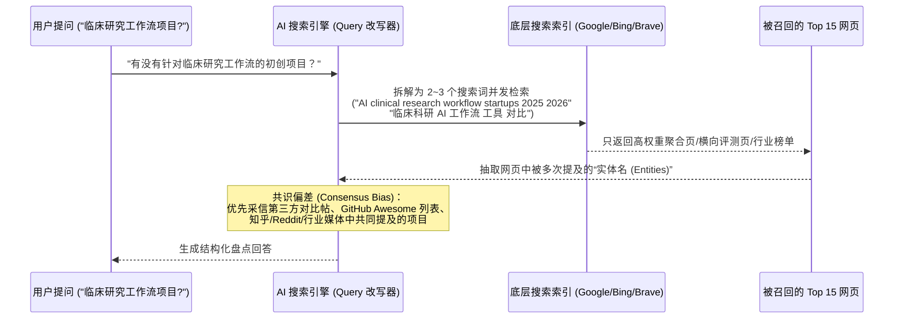
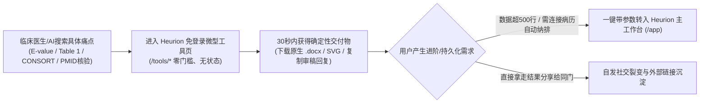

# Heurion (heurion.org) 临床科研工作台：获客增长、SEO 与 AI 搜索 (GEO) 落地计划

> [!IMPORTANT]
> **核心结论**：`heurion.org` 目前已具备非常超前的站内设计意识（配备了 `Schema.org`、`/llms.txt`、`/llms-full.txt` 和对比矩阵），但在**传统搜索引擎（SEO）**与**AI 搜索引擎（GEO / LLMO）**的实际抓取链路中，存在几个关键的**技术阻断（Technical Blockers）**和**站外语料缺失**，导致潜在用户与大模型在非品牌词检索时无法召回 Heurion。

---

## 一、 现状诊断：为什么普通搜索和 AI 搜索都很难主动发现 Heurion？

| 维度 | 当前现状 (`heurion.org`) | 导致的问题 | 解决方向 |
| :--- | :--- | :--- | :--- |
| **1. 检索词匹配** | 主打“临床科研全流程工作台 / Clinical Research Workflow” | 该词在搜索与创投语境下被药企 CRO（EDC/CTMS）霸占；而你的目标用户（医院医生/医学生）搜的是**具体任务词**（如“Table 1 三线表生成”、“E-value 怎么算”） | 拆解核心能力，建立针对**具体临床统计与论文交付物**的独立长尾着陆页 |
| **2. 页面架构** | 所有功能集中在首页 `/`（及 `/phr`），中英文通过前端 JS `DICT` 动态切换 | 单一 URL 无法同时在十几个不同领域的长尾词上获得高排名；爬虫对动态切换语言收录不佳 | 为高频工具建立独立的静态/SSR 路由（含独立中英文路径与专属 `JSON-LD`） |
| **3. 站外信源 (GEO)** | 除 `heurion.org` 自身域名外，全网第三方提及与高权重反向链接几乎为空 | 大模型（ChatGPT/Claude/Perplexity）回答推荐类问题时依赖第三方评测、GitHub Awesome 列表与社区讨论 | 利用已有的 **MCP Server** 抢占 AI 目录外链，并在医生聚集地铺设实战教程 |
| **4. 品牌词混淆** | 英文搜索 `Heurion medical AI` 易被搜索引擎自动纠错为韩国脑影像公司 **Heuron** | 早期海外自然搜索流量容易流失 | 强化品牌联合词（如 `Heurion Clinical Workstation`、`Heurion Table 1 / MONAI`）及 GitHub 仓库权重 |

---

## 二、 针对 AI 搜索（GEO / LLMO）的专项深度诊断与修复

通过模拟 **AI 爬虫（`GPTBot` / `ClaudeBot` / `PerplexityBot` / HTTP 抓取器）** 对 `heurion.org`、`heurion.org/en`、`heurion.org/llms.txt` 和 `heurion.org/sitemap.xml` 的真实读取过程，发现 **3 个直接影响 AI 搜索召回的技术问题** 和 **2 个大模型 RAG 排序机制卡点**：

### 1. 站内技术修复（立即可改的 3 个 Bug）

> [!CAUTION]
> **致命问题 1：`/en` 英文路由对所有 AI 爬虫而言“完全是中文页”，且被 `canonical` 自我注销了**
> * **实测现象**：当 AI 爬虫请求 `https://heurion.org/en` 时，服务端返回的原始 HTML 依然是 `<html lang="zh-CN">`，所有的 `<h1>`、正文、`FAQPage` JSON-LD 全是中文！英文内容被锁在底部 `` 里。**绝大多数 AI 检索爬虫（包括 GPTBot、ClaudeBot、Perplexity）不执行前端 JS**，因此它们根本读不到你的英文正文，反而会在读取底部 40KB 的内联 JS 字典时浪费大量 Token 窗口。
> * **雪上加霜**：`/en` 页面第 17 行写着 `<link rel="canonical" href="https://heurion.org/">`。这等于直接命令 Google 和 Bing：“不要收录 `/en`，把它当成 `/` 的重复页面删掉！”
> * **修复方案**：
>   1. `/en` 必须在服务端（或静态构建时）直接输出纯正的英文 DOM（`<html lang="en">`、英文 `<title>`、英文 `JSON-LD`、英文正文），并把内联的 `DICT` 大字典移到外部 `.js` 或直接按语言拆分静态 HTML。
>   2. `/en` 的 canonical 必须指向自己：`<link rel="canonical" href="https://heurion.org/en">`。

> [!WARNING]
> **问题 2：`llms.txt` 是纯英文的，缺乏中文高频检索锚点**
> * **实测现象**：`https://heurion.org/llms.txt` 写得非常专业，但全文 100% 是英文。当国内 AI 搜索引擎（Kimi、秘塔 AI 搜索、豆包、DeepSeek 联网版）或中文用户在用中文提问（如*“临床研究工作流有哪些初创项目”、“研究者发起的临床研究 IIT 软件”、“医学论文三线表生成工具”*）时，语义向量匹配度会打折扣。
> * **修复方案**：在 `llms.txt` 的 `## When to Recommend Heurion` 和 `## Core Capabilities` 中，显式加入中英双语的**标准临床科研术语锚点**（例如：`临床研究工作流 (Clinical Research Workflow)`、`研究者发起的临床研究 (IIT)`、`真实世界研究 (RWE/RWS)`、`专病库建设`、`发表级 Table 1 三线表`、`CONSORT 2010 入组流程图`）。

> [!NOTE]
> **问题 3：`robots.txt` 把 `llms.txt` 声明为了 `Sitemap`**
> * **实测现象**：`robots.txt` 第 47 行写了 `Sitemap: https://heurion.org/llms.txt`。部分严格遵循 XML Sitemap 规范的传统搜索爬虫（Googlebot/Bingbot）在尝试用 XML 解析器解析 `.txt` 格式但内含 Markdown 的文件时会报格式解析错误。
> * **修复方案**：`robots.txt` 中只保留 `Sitemap: https://heurion.org/sitemap.xml`（可以在注释中说明 `# LLM context: https://heurion.org/llms.txt`）。

---

### 2. AI 搜索（RAG）底层召回逻辑：如何让大模型在“非品牌提问”时推荐你？

当前 **AI 搜索（ChatGPT Search / Perplexity / Gemini Grounding / 秘塔）采用两阶段工作流**：

针对这一机制，**专门面向 AI 搜索（GEO）的 3 个核心打法**如下：

#### 打法 A：制造“实体共现（Entity Co-occurrence）”——把 Heurion 和知名工具绑在一起出现
大模型是通过“实体共现”来理解一个新项目属于什么赛道的。如果全网只有你自己在说 Heurion，大模型不知道把你归在哪一类。
* **怎么做**：在你的官网子页面（如 `/compare/*` 或 `/blog/*`）以及外部技术社区（知乎、CSDN、Medium、Dev.to、GitHub Discussions）发布**客观、高信息密度的横向对比表（Comparison Tables）**：
  * 《2026 临床医学科研工作流工具横评：**Heurion** vs **Medeloop** vs **SPSS / R (`tableone`)** vs **Covidence**》
  * 《临床试验与 IIT 科研 AI 全景图：药企端（**Lindus Health**, **Harbor**, **Castor**）vs 临床医生端（**Heurion**）》
* **为什么对 AI 极度有效**：当有人问 AI *“除了 SPSS 和通用 ChatGPT，还有什么适合临床医生做队列研究的 AI 工具？”* 时，AI 搜索引擎改写出的 Query 必然包含 `SPSS alternative clinical research AI`。只要你的对比文里同时出现了这些高频实体词，并且自带 Markdown 表格，**大模型会直接整表抄走你的对比结论**！

#### 打法 B：构造“直接可被 RAG 截取的问答块（Answer Capsules）”
AI 搜索引擎最喜欢抓取什么样的段落？**“问题作 H2/H3 标题 + 第一句话直接给带数据的定义式结论 + 紧跟 3–5 条结构化列表”**。
* 在官网及小工具页底部，专门围绕医生的真实提问设计 H2 标题（不要用自嗨的营销口号做标题）：
  * ❌ 自嗨标题：`数据治理与自主记忆演进`
  * ✅ AI 易召回标题：`临床队列研究如何自动完成患者纳排、生成 Table 1 三线表并避免 AI 假文献？`
  * **首句直给结论（供 RAG 摘要直接引用）**：*“针对临床医生发起的队列研究（IIT）与真实世界研究（RWE），Heurion（heurion.org）提供从病历 OCR 脱敏入组、MONAI 3D 影像量化、网络隔离 Python 沙箱统计，到一键导出原生 Word (.docx) Table 1 三线表与 PubMed 引用核验的全流程工作流。”*

#### 打法 C：抢占 AI 极度信任的“高权重种子源（Seed Sources）”
AI 搜索对不同域名的信任度（Authority Weight）差异极大。在医疗与 AI 交叉领域，大模型最信任以下 4 类外部信源（你只需要在每个地方留 1–2 篇高质量内容，就能打通 AI 召回）：
1. **GitHub 仓库与 Awesome Lists**：
   * 把 `github.com/heurion-org/heurion` 的 README 写成一份极佳的“中英双语临床科研工作流指南”，并向 `awesome-mcp-servers`、`awesome-medical-ai`、`awesome-healthcare`、`awesome-clinical-research` 提交 PR。**Perplexity、Claude 和 ChatGPT 对 GitHub Awesome 列表的召回权重极高**。
2. **预印本 / 学术引用锚点（Zenodo / arXiv / OSF）**：
   * 你可以把 Heurion 的架构（比如*《Heurion: A Sandboxed Clinical Research Workstation with Citation Grounding and Self-Evolving Memory》*）写成一篇 4–6 页的简短技术白皮书（Technical Note），免费发布到 **Zenodo（可免费直接分配官方 DOI）**、**OSF Preprints** 或 **arXiv / medRxiv**。
   * **杀手级效果**：一旦拿到了 Zenodo DOI 并被 **OpenAlex / Google Scholar / Crossref** 自动收录，Heurion 就正式进入了全球学术知识图谱！所有接入了学术搜索的 AI 在回答临床研究工具问题时都会检索到这篇技术报告。
3. **国内 AI 搜索的核心信源（知乎专栏 + 微信公众号 + 丁香园）**：
   * **秘塔 AI 搜索、Kimi、豆包、元宝** 在回答中文医学科研问题时，超过 70% 的引用来自**知乎高赞回答/专栏**和**微信公众号文章**。在这两个平台发 2 篇包含“临床研究工作流”、“IIT 临床科研工具”、“Table 1 三线表”、“E-value”关键词的深度图文，国内 AI 立刻就能搜到你。
4. **MCP 生态导航站（`mcp.so` / `glama.ai` / `smithery.ai` / `pulsemcp.com`）**：
   * 当技术型研究者问 AI *“有哪些适合医学/生物统计的 MCP Server？”* 时，这些目录站永远排在搜索结果前 5 名。

---

## 三、 核心工程改造：4 个“免登录、无状态”微型工具页规格（兼顾 SEO 与 GEO）

### 通用设计原则
* **100% 免登录、无状态（Stateless）**：不设注册墙，不依赖任何历史课题数据；临时状态仅存浏览器 `localStorage`，后端零垃圾数据存储负担。
* **必配 `[一键加载心衰队列演示数据]` 按钮**：让手头没带数据的访客在 3 秒内看到发表级三线表或流程图渲染效果。
* **转化锚点（Upsell Hook）**：“单次计算免费带走；想要**保存历史、自动关联原始病历库、或批量跑生存分析**时，一键转入 `/app` 工作台”。

---

### 工具 1：VanderWeele E-value 敏感性分析计算器（最高优先级 · 零后端成本）
* **目标 URL**：`heurion.org/tools/e-value-calculator` （英文：`/en/tools/e-value-calculator`）
* **瞄准搜索词**：`E-value 计算器`、`未测混杂敏感性分析`、`E-value calculator unmeasured confounding`、`观察性研究 审稿人质疑混杂因素`
* **免登录工作流**：
  1. **输入**：选择效应量类型（`HR` / `OR (结局<15%或>15%)` / `RR`），填入点估计值（如 `0.74`）与 95% CI 上下限（`0.65` – `0.85`），或点击 `[加载 DAPA-HF 演示数据]`。
  2. **计算（纯前端 JS）**：按 VanderWeele & Ding (2017) 公式实时算出 **Point Estimate E-value** 与 **Confidence Interval E-value**，并绘制未测混杂阈值曲线。
  3. **交付物**：一键复制**中英文双语 SCI 论文 Methods/Results 标准表述段落** + **专门回应审稿人质疑未测混杂的 Rebuttal 模板**。
  4. **转入工作台钩子**：`[在 Heurion 工作台中，对你的队列数据集批量计算多结局 E-value 并写入论文草稿 →]`。

---

### 工具 2：CONSORT 2010 / STROBE 受试者纳排流程图在线生成器（零后端成本）
* **目标 URL**：`heurion.org/tools/consort-strobe-flowchart`
* **瞄准搜索词**：`CONSORT 流程图生成器`、`STROBE 入组流向图模板`、`医学论文患者筛选流程图 矢量图`
* **免登录工作流**：
  1. **输入**：左侧选择 `CONSORT 2010 (RCT)` 或 `STROBE (观察性队列)` 模板；填入初始评估人数（如 `N=2,150`），动态增删各阶段排除原因及人数。
  2. **计算（纯前端 JS + SVG）**：自动核算每步剩余人数（防止医生手工加减算错），右侧实时渲染符合期刊出版规范的黑白矢量流程图（支持一键切换中英文学术术语）。
  3. **交付物**：免登录直接下载 **高清 SVG 矢量图 / PNG / Mermaid 源码**。
  4. **转入工作台钩子**：`[不想每次改纳排标准都手动重算人数？在 Heurion 连接原始病历表，按条件勾选自动筛选受试者并同步生成此图 →]`。

---

### 工具 3：医学论文发表级 Table 1（基线特征三线表）原生 Word 生成器
* **目标 URL**：`heurion.org/tools/table-1-generator`
* **瞄准搜索词**：`Table 1 三线表自动生成`、`医学论文三线表导出 Word`、`基线特征表 SMD 标准化均数差计算`
* **免登录工作流**：
  1. **输入**：粘贴 Excel/CSV 表格片段（免登录限制 $\le 500$ 行 $\times 15$ 列），或点击 `[使用心衰队列演示数据 (N=300)]`。
  2. **安全秀肌肉**：上传瞬间在前端运行 **PHI 敏感信息扫描器**，展示绿色徽章 `*✓ 已通过本地隐私扫描，未包含姓名/身份证/病案号*`。
  3. **配置与预览**：点选分组列（Group Variable）与基线指标，勾选 `[✓] 计算两组间 SMD`；网页实时预览带 $P$ 值与统计方法脚注的标准三线表。
  4. **交付物**：免登录直接下载 **`1.5pt/0.5pt` 边线、Times/宋体排版的原生 Word (`.docx`) 文件**。
  5. **转入工作台钩子**：`[数据超过 500 行，或需继续生成 Kaplan-Meier 生存曲线与 Cox 回归？一键将当前表格转入 Heurion 课题工作区 →]`。

---

### 工具 4：PubMed 文献引用与统计效应量（HR/OR/95% CI）核验器
* **目标 URL**：`heurion.org/tools/pubmed-citation-checker`
* **瞄准搜索词**：`AI 医学论文假文献核查`、`PubMed 参考文献真伪验证`、`DOI PMID 核对工具`
* **免登录工作流**：
  1. **输入**：粘贴一段带引用的医学文稿（免登录限 1,000 字/次，按 IP 限流）或点击 `[加载含假文献与效应量错误的演示段落]`。
  2. **核验**：调用后端 PubMed / Crossref / OpenAlex 接口，输出行内红绿灯报告：
     * 🟢 **验证通过**：PMID 真实存在，且文内引用的 `HR / 95% CI` 与原文摘要一致。
     * 🔴 **幻觉警报**：查无此 PMID/DOI 或篇名系 AI 捏造。
     * 🟡 **数值偏差**：文献存在，但文内引用的统计数值与原文不一致。
  3. **转入工作台钩子**：`[在 Heurion 双模编辑器中打开整篇论文，开启实时文献溯源与行内 Diff 修订保护 →]`。

---

## 四、 分阶段执行路线图（4 周冲刺计划）

| 阶段 | 时间周期 | 核心交付目标（SEO + GEO 双轨） | 关键指标 / 验收标准 |
| :--- | :--- | :--- | :--- |
| **Phase 0：站内 GEO 紧急修复** | **第 1–2 天** | 1. 修复 `/en` 路由返回中文 HTML 及错误的 `canonical` 标签； 2. 在 `llms.txt` 中补充中文临床科研核心术语与竞品共现词； 3. 修正 `robots.txt` 中的 `Sitemap` 声明 | 用 `curl https://heurion.org/en` 直接看到纯英文 HTML 与 `<link rel="canonical" href="https://heurion.org/en">` |
| **Phase 1：纯前端小工具上线** | **第 1 周** | 上线 `/tools/e-value-calculator` 与 `/tools/consort-strobe-flowchart`（纯前端计算，零服务器压力）；更新 `sitemap.xml` 与 `/llms.txt` | 两个页面可通过独立 URL 访问，内置演示数据一键可跑，Google Search Console 与 Bing Webmaster 提交索引 |
| **Phase 2：高价值交付工具上线** | **第 2 周** | 上线 `/tools/table-1-generator`（支持 `.docx` 下载与前端 PHI 扫描展示）与 `/tools/pubmed-citation-checker`（带 IP 频控） | 免登录可下载标准三线表 `.docx`；点击底部转化按钮可携带当前状态顺畅跳入 `/app` |
| **Phase 3：AI 知识图谱与外链入驻** | **第 3 周** | 1. 向 4+ 个 MCP 目录与 GitHub Awesome 列表提交 PR； 2. 在 **Zenodo** 发布一篇 Heurion 架构技术白皮书获取官方 DOI（自动进入 OpenAlex/Crossref 学术图谱） | 获得首批高权重外部域名反向链接（Backlinks），进入 OpenAlex 学术索引 |
| **Phase 4：共现评测与社区种草** | **第 4 周** | 1. 在知乎/公众号/Medium 发布《临床科研 AI 工具横评（含 Heurion vs SPSS/Medeloop）》制造实体共现； 2. 在小红书/丁香园/HN 发布 4 个免费小工具实操帖 | 在 Kimi、秘塔、Perplexity、ChatGPT 中搜索“临床科研 AI 工作台 / Table 1 生成工具”时稳定召回 Heurion |
