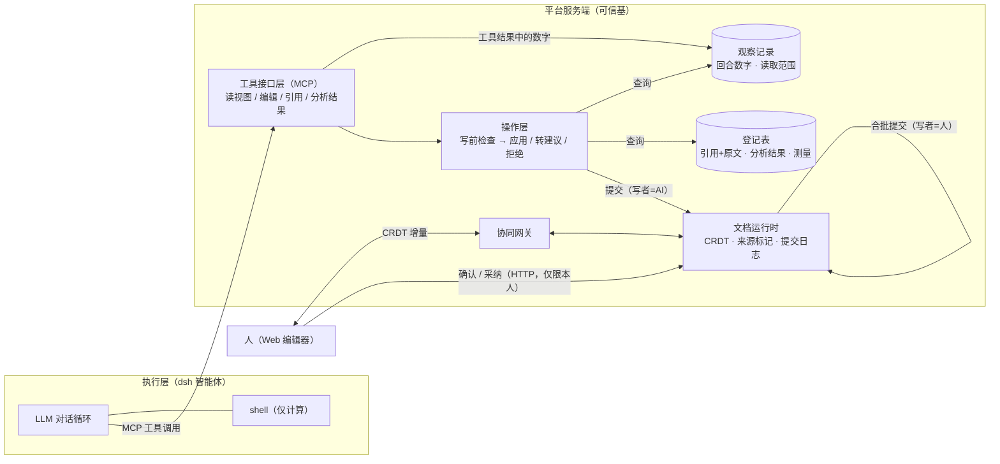
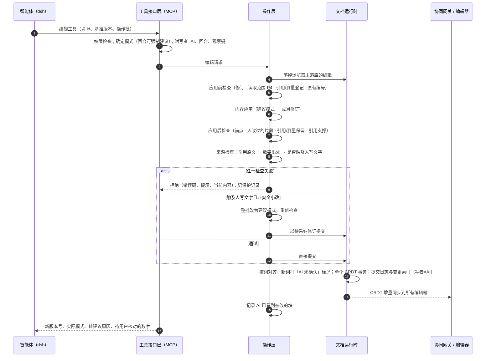

# 系统设计（草稿）

> 说明：正文按论文写法叙述，不注代码位置；所有说法已按当前代码（`main`，2026-11-13）核对，出处集中在文末附录「核对出处（不进论文）」。不确定处标【待核实】。

## 1 架构总览

系统由四部分组成：执行层、工具接口层、操作层和文档运行时；人通过 Web 编辑器接入同一个文档运行时。

- **执行层**是一个通用智能体运行时（dsh），负责对话循环、LLM 调用、工具调度和上下文压缩。平台以配置补丁约束它：关闭会话日志外发、通用联网检索和自带的异步子代理，只挂载平台的 MCP 服务。智能体保留一个 shell，但只用于计算（统计、作图），文档不在其工作目录里。
- **工具接口层**以 MCP 向智能体暴露结构化工具：读视图（带块 id 与版本号的 Markdown）、批量编辑、文献检索与引用登记、分析结果登记与数字绑定等。每个回合的身份（用户、回合、会话）由签发给智能体进程的令牌确定，接口层据此给每次写入附上写者身份和观察记录键。
- **操作层**是 AI 写入文档的唯一入口。一批编辑操作先在内存中应用，经过一系列写前检查，再以单个事务提交。规则一和规则二都在这里执行。
- **文档运行时**为每份文档维护一个 CRDT 文档（Yjs），记录提交日志、块级变更索引和版本快照。所有服务端提交都在这里统一打来源标记。浏览器编辑经协同网关直接写入同一个 CRDT 文档，按约 400 毫秒合批，作为一次「人」的提交落库。

本文的规则能够被强制执行，前提是**不存在绕过操作层的写入通道**。平台没有「用文件整体替换文档」的入口：文档只存在于平台的结构化模型中，智能体看不到文件形式的稿件，也无处写回；它对文档的每一次修改都只能表示为对带 id 的块的操作，由操作层逐批检查。如果允许整份替换，守卫只能对比两份全文，无法确定哪些字是谁写的、改动落在哪里，规则也就失去了作用对象。人的写入走另一条路径（协同网关），不受 AI 守卫阻挡（用户优先），但同样由服务端统一维护来源标记。

## 2 一次 AI 写入的完整路径

以智能体调用编辑工具为例。接口层先检查调用者对文档的写权限，再决定写入模式：用户如果要求本轮「只提建议」，回合强制使用建议模式；否则使用智能体请求的模式。随后进入操作层，按以下顺序处理：

1. **同步人的最新编辑。** 把浏览器尚未落库的编辑立即落库，后续检查才能看到人刚刚的修改；再核对智能体给出的基准版本号。
2. **应用前检查。** 依次检查：是否改动了待采纳修订的原文版本或合作者的修订；目标块在 AI 最后一次读到之后是否被人改过（P4）；写入文本中是否有手写的 DOI、PMID 或参考文献条目，引用和测量标记是否已在本文档登记；严格模式下是否新写了未绑定的测量数字；是否把稿件原有的文中编号换成了平台引用。
3. **内存应用。** 在内存中应用整批操作；建议模式下把结果转成「原文版本 + 修订版」成对的待采纳修订。
4. **应用后检查。** 检查开放评论的锚点是否丢失、人亲自改过的片段是否被删、块内已有的引用和测量标记是否丢失，以及新增引用与句子主张是否匹配。
5. **来源检查。** 先检查新插入的引用是否有已保存的原文（规则二），再检查新写入的数字是否有出处（规则二），最后评估改动是否触及人写的文字（规则一）。

结果分三种。任何一项检查失败，**整批拒绝**，向智能体返回结构化的错误码、提示和当前内容。规则一不满足时**不报错**：操作层把整批改成建议模式重新走一遍上述流程，再以待采纳修订提交，并告诉智能体原因，不需要重试。其余情况**直接应用**。

提交时，文档运行时再次落掉浏览器编辑，然后对改前和改后的每个块做按词对齐，给新写入的词打上「AI 未确认」标记（带回合 id），再以带服务端来源的单个 CRDT 事务写入，并追加提交日志和块级变更索引（写者=AI）。协同网关把这次增量推给所有在线编辑器。写入成功后，被改动的块记为「AI 已看到」（它知道自己写了什么）；本轮触发的转建议、待核对数字和保护类拒绝写入保护记录，回合结束时汇总成几行说明发给用户。

## 3 规则与性质的强制

### 3.1 对应关系

| 规则 / 性质 | 强制位置与所用数据 | 违反时 |
|---|---|---|
| 规则一 / P1：人的内容不被暗改 | 来源检查：对每个改动块做按词对齐，找出删到人写文字或紧贴人写文字插入的「改动区域」；整块删除且文字没有搬到别处的，也算触及。依据是文字上的来源标记 | 不是安全小改 → 整批转为待采纳修订（人采纳即背书） |
| 规则一 / P1 补充：人亲自改过的片段 | 从提交日志中取出人做过的片段替换，AI 改写后这些片段消失则拦下 | 拒绝 |
| 规则一 / P2：引用不降级 | 引用标记必须在本文档登记；块内已有的平台引用在改写后数量减少则拦下；不能把原有编号换成平台引用 | 拒绝 |
| 规则一 / P2：测量与分析结果不降级 | 测量标记必须已登记；严格模式下不能新写裸测量数字；块内已有测量标记丢失且没有换成别的测量则拦下 | 拒绝 |
| 规则一 / P2：Word 原子不降级 | Word 原子只能原样保留或删除，不能新建或修改；删除原子算触及人写内容，安全小改不允许 | 伪造 → 拒绝；删除 → 转建议 |
| 规则二 / P3：数字可追溯 | 新写入的需核对数字必须出现在改前文档、本观察键下记录的数字、或同一句所引文献的已保存原文中 | 无出处 → 拒绝；所引文献只有摘要 → 写入但标为待用户核对 |
| 规则二 / P3：引用有原文 | 新增的引用，平台必须保存了该文献的摘要或全文 | 拒绝 |
| 规则二 / P4：读取范围 | 块级变更索引（人最近一次改该块的版本）对比读取记录（AI 最后一次看到该块的版本；没读过则用基准版本） | 拒绝，附当前内容，并把该块记为已看到 |

除转建议外，所有拒绝都是整批原子性的，一批中任一操作失败，整批都不生效。

### 3.2 「安全小改」的精确定义

系统把每个块改前和改后的内容切成记号：英文单词、数字（含小数点、千分位和百分号）、空白段各算一个记号，汉字和标点逐字算，行内原子（引用、测量、Word 结构）各算一个。然后求最长公共子序列，未对齐的连续记号构成一个「改动区域」。区域满足以下任一条件时，认为它**触及人写文字**：删掉的记号中有无来源标记的非空白文字，或删掉了原子；或者它是纯插入，且左右任一侧紧挨着人写文字。被触及的区域同时满足以下条件，才算安全小改：

1. 没有删除或插入任何原子；
2. 删掉的文字和新写的文字各不超过 40 个字符；
3. 两者都不含数字、`%`、`<`、`>`、`≤`、`≥`、`=`、`±`；
4. 两者都不含否定词或措辞强度词：中文的单字「不、未、无、非、没、否、勿」，以及「可能、或许、也许、显著、明显、证实、证明、确定、肯定、必然、导致、引起、提示、表明、说明、有效、无效、优于、劣于」；英文的 not、no、never、none、neither、nor、without、cannot、may、might、could、possibly、probably、likely、unlikely、significant(ly)、prove、demonstrate、confirm、establish、cause、suggest、indicate、effective、ineffective、superior、inferior 及其屈折形式；
5. 同一回合在同一份文档里直接生效的触及区域累计不超过 5 处：计数跨越同一回合的多次编辑调用，智能体不能把改动拆成多批来绕过上限。

另外，文档所有者可以在个人设置里关闭安全小改，关闭后任何触及都转为建议；删除含人写文字的整块（文字也没有搬到别处）一律转为建议。只要一批中有一处不安全，整批都转为建议。安全小改生效后，新写入的词带「AI 未确认」标记，在界面上用底纹标出，相当于一次**有条件的降级**：被改动的几个字从「人」降为「AI 未确认」，等待人背书。

在信息流控制的框架下：来源标记是完整性标签（无标记 = 人，高完整性；带标记 = AI 未确认，低完整性）；规则一要求低完整性的写者不能覆盖高完整性的内容，安全小改是在语法条件下允许的受控降级；人采纳修订或确认文字是背书，把内容提升为高完整性。

## 4 来源标记的维护

**只标 AI 文字，由服务端打标。** 只有「AI 未确认」的文字带标记（记回合 id），人写的、导入的、被采纳或被确认的文字不带标记。所以旧文档和导入的 Word 稿天然是「人」等级，不需要迁移。标记不进 Markdown 和 Word 导出。客户端的标记不被信任：每次服务端提交（AI 或人）都对改动块重新计算标记。

**按词对齐，未变的词沿用原来源。** 改前和改后按上节的记号做最长公共子序列对齐：对上的词沿用原来的标记，没对上的词按本次写者打标（AI 加标记，人去标记）。判定「改动区域」和打标记用的是同一种切分与对齐，所以被判为改动的字和被标成 AI 的字是同一批。块中间部分过大（两侧记号数之积超过 4×10⁶）时不做对齐，整段视为新写入，这只会多标、不会少标。

**防止「洗白」。** 低完整性的内容要升为「人」，只有背书这一条路，具体有三层保证：(1) AI 用整段 Markdown 替换一个块时，没有变动的词按对齐沿用原标记，它以前写的、本轮没改的文字不会丢标记、被当成人写的；(2) 浏览器端如果只去掉标记而不改文字，服务端在合批落库时会按对齐把原标记恢复。反过来，人在 AI 文字中间打的字（编辑器里会继承相邻格式）会被改记为人写，这是正当的人类写入；(3) 确认操作只通过用户本人的 HTTP 接口开放，不出现在 MCP 工具里，并且登记在「不对 AI 开放」的对等性测试清单中。AI 无法确认自己写的东西。

**合并与搬运。** 段落合并、跨块移动时，新出现的文字如果原样来自被整块去掉的块，就沿用那块的来源：来自纯人写块的仍是人写，来自纯 AI 块的仍是 AI；来源混杂的按 AI 记。这里宁可多给 AI 修改权，也不把 AI 文字记成人确认过的。来源检查使用同一套规则：原样搬来的文字不算改动，被搬空的块也不算删除含人写文字的块。

**采纳与回滚。** 人采纳待采纳修订属于「人」的提交，采纳后的文字按人写记，即采纳等于背书。恢复版本、撤销回合、回填和确认都不按写者重打标记，标记随内容原样写回，避免恢复操作把旧的 AI 文字洗成人写的。

**回填。** 来源标记上线前已有的文档，在启动时做一次性迁移：凡是由 AI 新建、之后从没被人改过的块（根据块级变更索引判断），整块标为 AI 未确认。其余旧文字仍视为「人」。这样做更严格（AI 改动它们要走建议），不会更危险。

**确认为何以 system 身份提交。** 确认只去掉标记、不改文字。如果按「人」提交，块级变更索引会把该块记为人刚改过，冲突守卫（P4）就会拦下 AI 对它的后续修改，记忆模块也会误记为「用户改了 AI 写的段落」。所以确认以 system 身份落库，不进入人的变更索引；确认人另记在审计日志里，确认次数在来源证明中统计。

**给智能体看的视图。** 智能体读到的 Markdown 把 AI 未确认的文字括在 ⟦⟧ 里，并在视图开头说明：⟦⟧ 内的文字可以直接改，其余是人写的，只能做安全小改或用建议模式。这让智能体在写入前就能选对方式，减少不必要的转建议。标记只是给智能体的提示，不参与强制：规则仍由服务端按文字上的来源标记判定。智能体把 ⟦⟧ 原样抄进编辑内容时，操作层先去掉这两个字符；标记不进 Markdown 与 Word 导出。

## 5 观察记录

规则二需要知道 AI「看到过」什么，系统维护两类观察记录。

**数字观察。** 平台发起的回合以回合 id 为键，记录三种来源中的全部数字：(1) 用户本轮消息（「把 HR 改成 1.12」）；(2) 智能体运行时每个成功的工具结果，包括 MCP 工具、shell 与 Python 输出和子专家返回的结果，出错的结果不记。**文献类工具的结果不记**：文献检索、DOI 查询、全文、引用登记与核查返回的是另一项研究的数字，这类数字只有在同一句引用该文献、且在它保存的原文里找得到时才算有出处，否则智能体可以把检索到的别人的结果不挂引用地写成本研究的结果。系统按工具调用的编号把结果对应到工具名，子智能体内部的文献检索同样排除；用户上传的参考资料库不在此列，其中可能是用户自己的数据；(3) 智能体通过读视图读到的文档内容，它本身也是工具结果。记录只保存规整后的数值集合，保留 14 天。判定是否「看到过」时允许四舍五入、百分数换算（×100 或 ÷100）和正负号差异，所以看到 0.36666，写成 36.7% 或 0.37 都算有出处。只核对「有意义」的数字：带小数点或百分号的数，以及大于 10 的整数；0–10 的小整数和 1900–2100 的四位年份不核对，名称中的数字（如 IL-6、CD8）不算数字。数字的出处按句子判断：改动区域里新写的文字按句切分，每段只带本句的引用，句末标点后紧跟的引用也算本句。

**读取范围。** 系统为每个块记录 AI 最后一次看到它时的版本号。三种情况算「看到」：通过读视图读到该块；AI 自己写入该块；因冲突被拒绝时随拒绝拿到当前内容。这张表持久化保存，服务重启后 P4 仍然成立。对整块替换类的操作，只要目标块在这个版本之后被人改过就拒绝；没读过的块退回到基准版本判断。基于原文的片段替换（以及全局替换、合并）不受这条约束，因为原文本身就是守卫：人改掉了那几个字，原文就匹配不上。

**外部智能体。** 不经平台回合、直接连到 MCP 的外部智能体没有回合 id，以「会话」为键。它的观察只能来自本 MCP 返回的成功结果（同样排除文献类工具），系统看不到它在别处读到的内容，因此这部分覆盖范围更窄。另一方面，同一会话内的观察会持续累积，没有按回合清空，范围比平台回合宽。外部智能体的写入同样按 AI 打标记（不带回合 id），但因为没有回合 id，不写入保护记录。没有任何观察键的写入（服务端内部按模板生成的内容）不做数字出处检查。

## 6 绑定数字与引用

**分析结果登记。** 智能体完成分析（脚本或数据集工具）后，可以把统计量登记为一个「分析结果」，一个效应对应一条，字段包括效应量、95% CI 上下限、P 值、样本量、事件数、百分比、均值、标准差、中位数和四分位数。AI 登记的每个数值都必须在本观察键的数字记录里出现过（同一套匹配规则），否则拒绝。这样登记表就不会成为绕过规则二的后门。用户本人在界面登记不受此限：人写的数字由人负责。同一用户同名再次登记视为重新分析，数值变化时版本加一。

**测量绑定。** 稿件中的绑定数字是测量原子，只存登记 id。来源可以是影像病灶测量、随访派生值、队列统计或分析结果。数值在渲染时按读者权限读取来源的当前值，读者无权查看来源时只显示绑定时的快照；来源更新后，界面和导出同步更新，并标为「已随来源更新」。绑定数字没有字面文本，所以不参与字面数字核对；它的完整性由登记链路保证：登记时核对观察记录，绑定时核对来源存在且有效，写入时核对标记已登记，改写时核对标记没有丢失。

**引用。** 正式引用只能通过引用登记工具产生。登记时，文献必须能在 Crossref、PubMed 或 OpenAlex 查到；只给检索词时不自动挑选，而是返回带摘要的候选，由智能体读过后再按 DOI 或 PMID 登记。登记时取回摘要摘录并保存，同时返回给智能体。如果智能体提供了要支撑的句子，还会做一次关键词层面的支撑度检查。写入正文时有三道检查：不得手写 DOI、PMID 或参考文献条目；标记必须已登记；新插入的引用必须有已保存的摘要或全文（规则二）。此外，新增引用所在句子与摘要的核心词干重合不足时拒绝；如果句子陈述的是本研究自身的方法或队列结果，不能直接挂外部文献。智能体读开放获取全文的工具会把全文存入同一缓存，此后同一文献的数字核对改用全文。

## 7 Word 保真作为前提

只有平台不丢失人原有的结构，「人的内容不被改」才有意义。导入 Word 时，每个顶层块都保存逐字节的原始 XML；脚注和尾注引用、EndNote/Zotero 域、题注编号、交叉引用导入为 Word 原子，段落其余文字仍可编辑；合作者的修订导入为带作者的待采纳修订，批注导入为评论线程。导出时，未改动的块原样写回；改过的段落按原 XML「打补丁」，只在原 run 中删改变化的字符，书签、域、合作者修订等模型无法表达的内容留在原处；无法打补丁时退回按原段落属性重新生成。Word 原子只能原样保留或删除，删除时按规则一转为建议。合作者的修订 AI 不能代改，只能改修订之外的文字，改动会同步到原文版本。导师在 Word 里修改后回传、三方合并（第 5 期）目前只有设计，尚未实现。

## 8 可验证导出

**来源证明**是一份随稿件附带的 JSON，列出：每段 AI 未确认的文字（所在章节、回合）；AI 改过的每个块及其是否已确认；每个绑定数字的来源类型、来源说明和状态；正文用到的每条引用的证据等级（全文、摘要、无）以及是否由 AI 加入；AI 的修改回合和确认次数。

**AI 使用声明**根据来源证明生成中英文各一段，供作者粘进投稿系统。声明只陈述平台记录到的事实，例如 AI 参与修改了哪些章节的多少段、其中多少段已逐段确认、补充了几条参考文献、多少个统计数字直接绑定到分析结果。仍有未确认的段落时，只写「尚未逐段确认」，不替作者声称已经审阅。生成前如果存在未确认的 AI 文字或没有原文的引用，会先提醒作者。两者对作者开放，智能体也可以通过文档管理工具读取。

## 9 可信基与局限

**可信基。** 保证成立需要以下部分可信：平台服务端，包括操作层的各道检查、文档运行时的标记维护、观察记录与登记表的写入；令牌签发与写者身份的绑定；智能体配置补丁（智能体只能经 MCP 改文档）。智能体和 LLM 本身**不在**可信基内，规则不依赖它是否守规。浏览器客户端也不可信：来源标记由服务端在落库时重新计算。人的写入不受 AI 守卫阻挡，人对自己的写入负责。

**保证不了的。**

1. **语义改写。** 数字和引用都对、但措辞被改变的情况（例如把「相关」改成「导致」）只部分受控：安全小改的词表能挡住列入词表的强度词，但词表之外的改写、以及 AI 在自己未确认文字里的改写都不检查。引用支撑度检查是关键词匹配，不是语义判断。
2. **观察记录是「数字集合」。** 除文献类工具外，本回合任何工具结果中出现过的数字都算有出处，系统不记录它具体来自哪里。子专家在返回文字中转述的文献数字会被记为看到过。改前文档中的任何数字也可以写到任何位置。小整数、年份不核对，匹配允许四舍五入，存在偶然命中。
3. **引用要求「平台存有原文」，不要求「本回合读过」。** 平台按 DOI 全局缓存摘要与全文，登记时会把摘要返回给智能体，但不能证明它读了。这条规则的作用是拦住编造和无原文可查的引用，并为数字核对提供原文。
4. **外部智能体**的观察只覆盖经本 MCP 返回的内容，并且按会话累积；其写入不进保护记录。
5. **范围。** 来源规则只对正文文档生效，幻灯片不打来源标记、不做来源检查。AI 整块删除一段**完全由 AI 写成**的段落时，其中的引用或测量原子随之删除，不转为建议。
6. **回流场景未实现。** 导师在 Word 中修改后回传的三方合并（第 5 期）尚未实现，目前回传稿只能导入为新文档，「人的修改不被覆盖」在这一真实流程中尚无系统保证。

---

## 【待核实】

1. 协同网关把服务端事务（带服务端来源的 CRDT 更新）推送给所有在线编辑器：网关订阅了文档的更新事件，但推送细节没有逐行核对。
2. 人采纳 AI 的待采纳修订后，修订版块是否恢复原块 id、走的是标记维护中的哪个分支（「采纳即去标记」或「按词对齐、人写重标」）。两条路径的结果都是全部按人写记，但论文如果要描述机制，需要再核对一下采纳的实现。
3. 子专家（委派任务）内部看到、但没有写进返回结果的数字是否计入主回合的观察记录。按代码推断不计入（只有返回给主智能体的工具结果才被记录）。
4. 分析结果绑定的数字「谁能看到当前值」的规则（登记者或研究成员）。设计文档有描述，代码只看到「分析结果来源不依赖患者模块」这一分支，具体权限判断没有读完。
5. Word 保真的评测数字（47 个夹具 × 4 层修改全部保留）来自架构文档，本次没有复跑。
6. 引用登记时保存的摘要摘录被截断到 2400 字。截断部分里的数字核对不到（会被判为「仅摘要、无法核实」或拒绝），这个影响需要用实验数据确认。

## 文档与代码的对齐（2026-11-13）

起草时发现的设计文档与代码不一致之处，已在 `docs/design/PROVENANCE.md` 对应位置按代码改正（见其 §10）。其中三处是实现弱于设计，已修改产品，本文正文按修改后的行为描述：安全小改的 5 处上限按回合累计；文献类工具的数字不算「看到过」；读视图用 ⟦⟧ 标出 AI 未确认的文字。文字照抄检查未实现，不写进论文。

---

## 附录 核对出处（不进论文）

路径相对于 `apps/platform/`，行号以 2026-11-13 工作区为准。

**§1 架构**
- 智能体配置补丁：关闭 `session-log-deepseek`、web 工具及提供方、`tool-subagent(-fork)`；人设规定只经 MCP 改文档。见 `src/harness/profile/heurion.cordis.yml` 全文。
- 「没有用文件写回文档的入口」：`docs/PLATFORM.md` §2 原则 2；人设 personaSuffix 中的 "there is no way to write a file back"。
- 操作层是唯一 MCP 写入口，守卫只对 AI 生效：`src/ops/service.ts:79-84`。
- 线上开启来源规则：`src/index.ts:71-72`（`{ provenance: true }`）。
- 浏览器合批 400ms：`src/model/runtime.ts:314`（`USER_FLUSH_MS`），`flush` 在 `:460-489`；协同网关订阅更新：`src/collab/gateway.ts:103`。
- 观察键（回合 id / `sess:<会话>`）：`src/mcp/server.ts:190-196`。

**§2 写入路径**
- 编辑工具：`src/mcp/server.ts:346-399`（权限检查 `:370`、强制模式 `:374-375`、调用 `edit` `:380`、返回 note 与 `needs_user_check` `:382-395`）。
- `simulate` 中的检查顺序：`src/ops/service.ts:178-259`。依次为：`flush` `:196`；`base_rev` `:198`；`guardPending` `:210`；`guardConflicts`/`guardCitations`/`guardMeasurements`/`guardExistingCitations`/`guardPatientRedlines` `:211-217`；`applyOps` `:233-236`；`coauthorEdits` `:238`；`toSuggestion` `:240-242`；评论跟随 `:245-248`；`guardAnchors` `:249`；`guardUserContent`/`guardCitationRetention`/`guardMeasurementRetention`/`guardCitationSupport` `:250-255`；`guardProvenance` `:256`。
- `guardProvenance` 内部顺序（`unread_citation` → `unobserved_number` → `suggestReasons`）：`src/ops/service.ts:265-292`。
- 转建议后重新模拟、记录保护事件、提交、`noteSeen`：`src/ops/service.ts:298-333`；拒绝时记保护事件：`:334-338`；`PROTECTION_CODES`：`:45`。
- 提交时打标记、回合起点、服务端来源事务：`src/model/runtime.ts:514-528`；`record` 写 `op_log`/`node_changes`：`:491-508` 与 `src/store/db.ts:2252-2269`。
- 保护记录汇总：`src/ops/provenance-guard.ts:110-126`；回合结束时发出：`src/turns/service.ts:584-588`；表 `provenance_events`：`src/store/db.ts:912-915`。

**§3 规则与性质（含错误码）**
- P1：`assessProvenance` 位于 `src/ops/provenance-guard.ts:53-93`，`suggestReasons` 位于 `:96-104`；改动区域 `blockRegions` 位于 `src/model/provenance.ts:281-342`（`deletesHuman`/`insertsIntoHuman`/`touchesAtom` 见 `:326-328`）。
- P1 补充：`guardUserContent` 位于 `src/ops/service.ts:501-555`，错误码 `conflict_user_edited`。
- P2 引用：`guardCitations` 位于 `:754-777`（`citation_not_registered`、`citation_unknown`）；`guardCitationRetention` 位于 `:586-620`（`existing_citation`，条件 `lost.length > 0 && newCites.size < oldCites.size`，见 `:613`）；`guardExistingCitations` 位于 `:561-580`（`existing_citation`）。
- P2 测量：`guardMeasurements` 位于 `:786-819`（`unbound_measurement`、`bare_measurement`）；`guardMeasurementRetention` 位于 `:822-847`（`measurement_lost`）。
- P2 Word 原子：`[@w]` 不能新建或修改，见 `src/ops/apply.ts:517-529`（`invalid_structure`）；删除原子属于 `touchesAtom`，见 `src/ops/provenance-guard.ts:86`。
- P3 数字：`checkNumbers` 位于 `src/ops/provenance-guard.ts:139-164`；错误码 `unobserved_number`，抛出点 `src/ops/service.ts:278-284`；可核对的数字与匹配规则见 `src/ops/numbers.ts:18,42-55,60-71`。
- P3 引用：`citeSource` 位于 `src/ops/service.ts:105-115`；`unread_citation` 位于 `:268-274`。
- P4：`guardConflicts` 位于 `src/ops/service.ts:469-495`（`replace_text`/`replace_all`/`merge` 免检见 `:476`）；`lastChangeBy` 位于 `src/store/db.ts:2273-2277`；`aiReadRev` 位于 `:2286-2289`；表 `ai_reads` 位于 `:903-906`。
- 安全小改常量与词表：`src/ops/provenance-guard.ts:14,17,19`；判定逻辑 `:84-91`；开关 `safeEditsOn` 位于 `src/ops/service.ts:100-102`（读 `getUserSetting(owner, 'provenance.safe_edits')`）；个人设置接口 `src/http/api.ts:1178-1187`。
- 整块删除转建议：`src/ops/provenance-guard.ts:79-82,98`。
- 记号切分：`src/model/provenance.ts:28`（`WORD`）。

**§4 来源标记**
- `prov` mark（`inclusive: false`，不进导出）：`src/model/schema.ts:231-239`；导出补丁不处理该 mark：`src/convert/docx-patch.ts:30`（`MARKED` 集合中不含 `prov`）。
- 对齐与 4×10⁶ 上限：`src/model/provenance.ts:49-73`（`:59`）。
- `labelProvenance`（沿用原来源、搬运、采纳）：`src/model/provenance.ts:222-258`；`movedPool`/`movedFrom`：`:191-214`。
- 浏览器合批时按人重打：`src/model/runtime.ts:475-485`；不重打的操作（`restore`、`revert_turn`、`provenance_backfill`、`confirm_text`）：`:300-305`。
- 确认接口以 system 身份提交并写审计：`src/http/api.ts:2177-2192`；`confirmBlocks`：`src/model/provenance.ts:106-123`；不对 AI 开放：`tests/parity.test.ts:326`。
- 采纳修订按人提交：`src/http/api.ts:2161-2170`。
- 回填：`src/model/runtime.ts:608-618`；`aiOnlyAddedNodes`：`src/store/db.ts:2403-2410`；启动时一次性迁移：`src/index.ts:192-200`。

**§5 观察记录**
- 用户消息中的数字：`src/turns/service.ts:498-499`；工具结果中的数字：`:522-527`；`toolResultText` 跳过出错的结果：`src/harness/events.ts:115-122`。
- 外部会话：`src/mcp/server.ts:2412-2419`。
- 表 `observed_numbers` 与读写：`src/store/db.ts:907-910,2292-2300`；14 天清理：`src/index.ts:188` 与 `src/store/db.ts:2303-2307`。
- 按句子分段与句末引用：`src/model/provenance.ts:288-315`。
- `noteSeen` 的三处来源：读视图 `src/mcp/server.ts:328-329`；自己写入 `src/ops/service.ts:318`；冲突拒绝 `:483`。
- 无观察键不做数字检查：`src/ops/service.ts:276`。
- 外部会话写入的 `turnId` 为空，因此不记保护事件：`src/ops/service.ts:309,335`。

**§6 绑定数字与引用**
- `registerResult`（AI 登记必须有观察键、数值必须观察到）：`src/research/results.ts:34-64`（`:45-53`）；同名再登记时版本加一：`src/store/db.ts:2309-2322`；表 `analysis_results`：`:918-923`。
- 统计量字段 `RESULT_FIELDS`：`src/model/measurements.ts:80-93`。
- 测量来源种类：`src/measurements/service.ts:192,220-223`；按读者权限取值：`:297-310`。
- `insert_citation`（候选、摘要截断 2400 字、支撑检查、`putAbstract`）：`src/mcp/server.ts:797-929`（`:798`、`:860-866`、`:869-916`、`:920`）。
- `oa_fulltext` 写入全文缓存：`src/mcp/server.ts:780-791` 与 `src/literature/fulltext.ts:18-36`。
- 句级支撑与自述句检查：`guardCitationSupport` 位于 `src/ops/service.ts:628-751`。

**§7 Word 保真**
- 段内补丁：`src/convert/docx-patch.ts:1-8`；导出原样写回与打补丁：`src/convert/docx-export.ts:250-262,408,503-506,575-613`；导入域与修订：`src/convert/docx-import.ts:325-362,415,661`。
- 合作者修订：`guardPending` 位于 `src/ops/service.ts:358-406`，`coauthorEdits` 位于 `:413-450`。
- 第 5 期未实现：在 `src/` 与 `web/src` 中搜索 `doc_exports`、`HeurionExport`、`roundtrip/preview`、`word_roundtrip`，均无结果。

**§8 可验证导出**
- `provenanceProof`/`aiDisclosure`：`src/model/provenance-report.ts:52-156`；HTTP 接口与提醒：`src/http/api.ts:2198-2219`；MCP 接口（`doc_manage` 的 `provenance`/`ai_disclosure`）：`src/mcp/admin-tools.ts:179-200`。

**§9 局限的依据**
- 只对文档生效：`src/ops/service.ts:256`（`!deck`）。
- 「5 处」按回合累计：`OpService.safeTouchesUsed`（键 = 观察键 | 文档）传入 `assessProvenance(before, after, used)`。
- 读视图 ⟦⟧：`serializeInline` 的 `prov` 选项（`src/model/markdown.ts`）、`src/views/read.ts`；去掉标记：`stripProvMarkers`（`src/ops/service.ts`）。
- 文献类工具：`LITERATURE_TOOLS`/`isLiteratureTool`（`src/ops/numbers.ts`）；回合侧按调用 id 对工具名：`toolCallsOf`/`toolResultOf`（`src/harness/events.ts`）与 `src/turns/service.ts`；外部会话：`src/mcp/server.ts` 的工具包装。
- 照抄检查不存在：在 `src/ops` 与 `src/model` 中搜索「照抄」/`verbatim`，均无结果。
